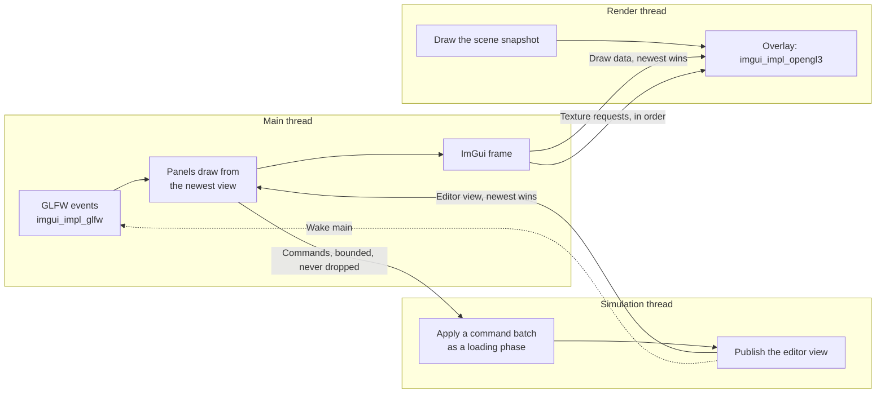

# Editor: Design

> Living design doc. The decisions that are hard to reverse are in
> [[ADR-027 - Editor threads, edit commands and play sessions]]. This note holds the *how*, and
> it is the E1 hub: plan and ground T1 work from here.

**Module:** `apps/editor` (ImGui, panels, commands) · `app` (command admission, the idle
simulation) · `client` (the overlay seam) · `core` (the field visitor, the `Name` component)
**Kind:** system
**Status:** designed on 2026-10-26 (S9-D3) against engine `c509ac3a`. Nothing is built yet:
Sprint 09's Story D, S9-T11 to S9-T19, builds it.
**ADRs:** [[ADR-027 - Editor threads, edit commands and play sessions]] ·
[[ADR-018 - Main and simulation threads, render-owned GL]] §1 §2 ·
[[ADR-015 - Threading (sim on main, render thread owns GL)]] §2 ·
[[ADR-019 - Fixed simulation ticks, render interpolation and shared clock]] §5 ·
[[ADR-016 - Serialization (binary primitives & describe-once seam)]] §2 ·
[[ADR-026 - Reference fields and scene-held acquires]] §4 ·
[[ADR-007 - v2 networking & ECS replication foundation]] §1
**Product:** [[Editor - Brief]] · **Research:** [[Editor - Research Brief]] ·
**Backlog:** [[Backlog]] → `editor & tooling`

## Purpose

E1's editor builds a scene: a hierarchy of named entities, an inspector that edits their
components, save with an unsaved marker, and a layout that is remembered. The hard part is
not the panels. The `Scene` belongs to the simulation thread, GL belongs to the render thread,
and ImGui's input and windows belong to main, so every panel reads a copy and every edit is a
message. This note says how those messages are shaped.

## Decided

| What | Call | Ref |
|---|---|---|
| One window | ImGui's docking branch draws into the client's window. Main builds the frame; render draws it after the scene. Multi-viewport is off in E1. | ADR-027 §1 |
| Draw data and textures | Draw data crosses newest-wins in its own channel. Texture requests cross in order and are never dropped. | ADR-027 §1 |
| Main stays event-driven | Main builds a frame on each wake. Extra frames come from posted wakes, never from a timer. | ADR-027 §1; ADR-019 §5 |
| Panels read a published view | The simulation publishes the hierarchy, the selected entity's components and the revisions after a change. Main never reads the live `Scene`. | ADR-027 §2 |
| Every edit is a command | Panels send commands through bounded admission; the simulation applies each batch as a loading phase and records old values. | ADR-027 §3 |
| Stopped, Playing, Paused | Only Playing ticks. E1 builds Stopped only, with the simulation thread alive and idle. | ADR-027 §4 |
| Play ticks a copy | E11 builds it. E1 keeps undo records and the selection in one place that Play can freeze. | ADR-027 §5 |
| The layout file | `<project>/editorSettings/layout.ini`, git-ignored, written through file access. | ADR-027 §6 |
| The overlay seam is a callback | `client` calls an overlay on the render thread; the editor fills it with `imgui_impl_opengl3`. | 2026-10-26, § *The overlay seam* |
| ImGui's GL is the one GL outside `client` | Third-party code in the editor issues GL, on the render thread only. | 2026-10-26; [[Window - Design]] |
| Every `visit` field has a name | `archive.field("mesh", value.mesh)`. `Writer`, `Reader` and `ReferenceVisitor` ignore it. | 2026-10-26; [[Serialization - Design]] |
| The inspector reads field rows | A field visitor in `core` flattens a component into rows; main draws widgets from rows and never sees the C++ type. | 2026-10-26, § *Fields* |
| Every entity has a name | A `Name` component, created with every entity. Names need not be unique. | [[Editor - Brief]], 2026-10-26 |
| Persistent entity ids stay opt-in | An entity's disk id is its row in its scene file, reassigned at each save. A UUID is an opt-in component for cross-document entities. | ADR-007 §1 |
| Save is a command | The simulation writes the scene and publishes the saved revision. Save is T1's; T2 keeps only Export. | 2026-10-26, § *Save* |
| No game input while Stopped | The editor detaches the `InputBuffer` while Stopped. ImGui reads input through its own callbacks. | 2026-10-26, § *Commands and the idle simulation* |

## Threads and channels

Each arrow is a copy under a short lock, never a shared reference. The simulation's existing
render snapshot still feeds the scene draw beside these.

## The overlay seam

`Client::start` takes an optional overlay. The runtime passes none, so `client` and the runtime
never link ImGui. The render thread makes three calls on it:

| Call | When |
|---|---|
| start | Once, after `gladLoadGL` succeeds and before the first frame. |
| draw | Every frame, after the scene draw and before `swapBuffers`, with the framebuffer size. |
| stop | Once, before the render thread releases the context, also after a failed frame. |

The editor's overlay owns `imgui_impl_opengl3` and the consuming side of both channels. On each
draw it applies every queued texture request in order, then draws the newest draw data, or the
last one again when none is new. It uses ImGui's threaded helpers, `ImDrawDataSnapshot` and
`ImTextureQueue` ([[Editor - Research Brief]] § *Dear ImGui over a render thread*).

- `imgui_impl_opengl3` embeds its own GL loader. Leave it: glad is private to `client`, and both
  loaders read the same current context.
- `ImGui_ImplOpenGL3_Init` needs a current context, so it runs in the overlay's start, on the
  render thread, never in the editor's `init()`.
- Main must hand over a snapshot of the draw data, never ImGui's own `ImDrawData`, which the
  next `NewFrame` rewrites while render may still be reading it.

## The ImGui frame on main

The editor creates the ImGui context in `init()` after `startClient()`, then initializes
`imgui_impl_glfw` on the window's native handle, which `Window` and `Client` expose to main.

- **Callback order bites.** `ImGui_ImplGlfw_InitForOpenGL` with installed callbacks chains the
  callbacks that `Window` set before it. It must run after `Window::open` and
  `setInputBuffer`, or `Window`'s callbacks replace ImGui's and ImGui gets no input.
- On each wake, main takes the newest editor view, runs `NewFrame`, draws every panel from that
  view, renders, and publishes the snapshot and the texture requests.
- ImGui settles some interactions over a few frames. After a frame that had input, or while
  ImGui reports an active item, main posts one more wake. With no input, main sleeps.
- `ClientApp::mainThreadUpdate()` already waits on events and sets the title. The editor's
  override builds the ImGui frame after the wait, and adds the unsaved marker to the title.

## Commands and the idle simulation

`app` holds the bounded admission that [[Simulation Thread - Design]] § *Input and control
handoffs* specifies: FIFO, a full or closed queue rejects visibly and never evicts, and
commands accepted but not applied at shutdown are reported as cancelled.

- A command is a type with one virtual `apply` that receives the live `Scene`. The editor
  defines the concrete ones: create, delete, reparent, select, add and remove a component, set
  a field, and save. `app` knows none of them.
- Each `apply` records what it needs to undo into the editor's edit session, the one place
  that holds undo records and the selection on the simulation thread (ADR-027 §5).
- A ticking app applies the batch before each fixed tick. An app whose simulation does not
  tick waits on the simulation thread's wake until a command arrives or stop is requested,
  applies the batch, then runs a publication hook. The runtime never submits a command, so its
  loop does not change.
- A batch is a loading phase (ADR-026 §4): a command that sets an `AssetRef` adds the id as a
  dependency of the scene entry, and the batch drains the load before it publishes.
- **The idle loop consumes no input.** `beginTick` is the only consumer of the `InputBuffer`,
  so a Stopped editor would fill it into overflow recovery. The editor detaches it while
  Stopped; Play, at E11, attaches it again.

## The published view

After a batch that changed anything, the simulation builds one view and publishes it into a
newest-wins slot under a short mutex, then calls `wakeMainThread()`. It holds:

- the hierarchy in tree order: each entity's handle, depth, name and child count;
- the selected entity, and its components as field rows (§ *Fields*);
- the edit revision, raised by every applied batch that changed the scene, and the saved
  revision.

Collapsed branches and scroll positions are main's own UI state, not part of the view. The
whole view is rebuilt on each change. At 1,000 entities that is a few kilobytes per edit;
ADR-027 § *What would move this* names the measurement that would change it.

**Drops the hierarchy refuses.** The panel refuses a drop onto the dragged entity or its own
subtree, using the published tree. A command the `Scene` still rejects, such as one for an
entity that died in the meantime, logs a warning and changes nothing. No caller needs to tell
the reasons apart, so the [[Backlog]]'s `bool` mutator entry stays armed.

## Fields: names, rows and edits

[[ADR-016 - Serialization (binary primitives & describe-once seam)]] §2 makes the inspector a
third visitor over `visit`. That needs a name per field, so `field` takes one first:
`archive.field("position.x", local.position.x)`. The name is a string literal. `Writer`,
`Reader` and `ReferenceVisitor` ignore it, so no byte on disk changes.

`core/serialization` gains a field visitor shaped like `ReferenceVisitor`: a templated
`field(name, value)` that dispatches to one virtual function per kind. Each registered
component gains a field walk in its registry record, beside `visitReferences`.

| Kind | Inspector widget |
|---|---|
| `bool`, signed and unsigned integers, `float`, `double` | Checkbox or drag field. |
| `std::string`, which includes the entity's name | Text field. |
| `StringId` | Read-only, shown as its hash. |
| `AssetRef<T>` | The asset id, editable. |
| `Entity` | Read-only in E1, shown as the target's name. |
| A bulk vector | Read-only, shown as its element count. |

The editor implements the visitor twice, both on the simulation thread: a collector that
turns a component into rows `{component type, field index, name, kind, value}`, and a setter
that writes one value at one field index. A set-field command carries the entity, the
component type, the field index and the value. The field index is the field's position in
`visit`, so it is stable within one build.

## Entity names

A `Name` component in `core/scene/components/` holds one `std::string`. `App` registers it
with `Hierarchy` and `Transform`, and every new entity carries it, named `Entity`. The type is
`Name` rather than v1's `Tag`, because `tag` already means a component's type tag
(`MeshRenderer::tag`), and v1's `Tag` also carried a uuid, which stays opt-in under ADR-007 §1.

- It is saved like any component. A scene saved before it has no `Name` block, so its
  entities load with the default name.
- The hierarchy shows the name, the inspector renames through a set-field command, and the
  runtime's scene log prints it ([[Editor - Brief]], 2026-10-26).
- An entity's disk id is its row, reassigned in tree order at each save, so a reparent
  renumbers the rows after it. Nothing in E1 refers to an entity from outside its scene.

## Save, the unsaved marker and close

Save is a command: the simulation writes the live scene with `SceneAsset::write` over the
startup scene's indexed file, then publishes the saved revision. `EditorApp::createAsset`
refuses an existing path, so save writes through `FileAccess` directly, not through it.

- Ctrl+S and a menu item send the save command. A failed write logs, and the marker stays.
- The title carries the unsaved marker while the published revision differs from the saved
  revision.
- A close request with unsaved edits opens a modal with Save, Discard and Cancel. Cancel has
  to clear GLFW's close flag, and `Window` has no way to do that today.
- E1 has one scene, the startup scene. Export stays at startup until T2 makes it a command.

## The layout

ImGui writes no file of its own: `io.IniFilename` is null. The editor reads
`project://editorSettings/layout.ini` through `FileAccess` when ImGui starts; `NotFound` means
the default layout, built with ImGui's dock builder: hierarchy left, inspector right, the
placeholder scene view in the centre. When ImGui sets `WantSaveIniSettings`, the editor saves
the layout through `FileAccess` and clears the flag. `editorSettings/` is git-ignored.

## Open questions

- **A field edit that must update derived state.** The setter writes `Transform`'s local values
  directly, which leaves its world values stale. Owner: S9-T17's `/card-start`.
- **The first kept save fires a trigger.** [[Serialization - Design]] says per-type versions
  wait for non-regenerable content, "which for scenes is T1's first kept save". S9-T18 is that
  save. Its `/card-start` decides whether versions are built then or the trigger is re-armed.
- **Presentation input while Stopped.** E2's scene view camera needs presentation input while
  the `InputBuffer` is detached. Owner: T3.
- **A second scene load in one process.** The [[Backlog]]'s "a scene load does not notice a
  reference that was already Failed" fires on the first reload. E1 never reloads.

## References

- Built by Sprint 09's Story D ([[2026-10 Sprint 09 - Close M6]]).
- Today's editor: `apps/editor/src/EditorApp.cpp`; its client base:
  `apps/clientapp/src/ClientApp.cpp`; the loop that idles: `engine/app/src/SimulationThread.cpp:188-200`.
- The render frame the overlay joins: `engine/client/src/render/RenderThread.cpp:97-134`.
- The visitors that gain names: `engine/core/include/TechEngine/core/serialization/Writer.hpp:85`,
  `Reader.hpp:97`, `ReferenceVisitor.hpp:24`.
