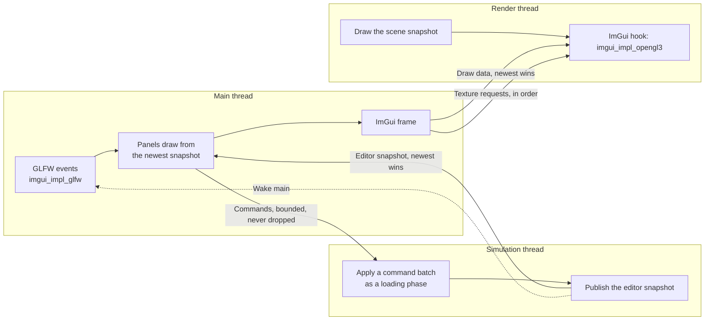

# Editor: Design

> Living design doc. The decisions that are hard to reverse are in
> [[ADR-027 - Editor threads, edit commands and play sessions]]. This note holds the *how*, and
> it is the E1 hub: plan and ground T1 work from here.

**Module:** `apps/editor` (ImGui, panels, commands) · `app` (command admission, the idle
simulation) · `client` (the ImGui hook) · `core` (the field visitor, the `Name` component)
**Kind:** system
**Status:** designed on 2026-10-26 (S9-D3) against engine `c509ac3a`. The ImGui hook and the
frame on main are built (S9-T11, #162 `6df5fa6`), and so are the command admission (S9-T12, #163
`3165f73`), the idle simulation (S9-T13, #166 `db2adac`), entity names (S9-T15, #167
`9a33c49`), and the editor snapshot, the dockspace and the hierarchy panel (S9-T16, #171
`acc897a`). The rest of Sprint 09's Story D, S9-T17 to S9-T19, builds the inspector, save and
the remembered layout.
**ADRs:** [[ADR-027 - Editor threads, edit commands and play sessions]] ·
[[ADR-018 - Main and simulation threads, render-owned GL]] §1 §2 ·
[[ADR-015 - Threading (sim on main, render thread owns GL)]] §2 ·
[[ADR-019 - Fixed simulation ticks, render interpolation and shared clock]] §5 ·
[[ADR-016 - Serialization (binary primitives & describe-once seam)]] §2 ·
[[ADR-026 - Reference fields and scene-held acquires]] §4 ·
[[ADR-007 - v2 networking & ECS replication foundation]] §1
**Product:** [[Editor - Brief]] · **Research:** [[Editor - Research Brief]] ·
**Backlog:** [[Backlog]] → `editor & tooling`

## Purpose

E1's editor builds a scene: a hierarchy of named entities, an inspector that edits their
components, save with an unsaved marker, and a layout that is remembered. The hard part is
not the panels. The `Scene` belongs to the simulation thread, GL belongs to the render thread,
and ImGui's input and windows belong to main, so every panel reads a copy and every edit is a
message. This note says how those messages are shaped.

## Decided

| What | Call | Ref |
|---|---|---|
| One window | ImGui's docking branch draws into the client's window. Main builds the frame; render draws it after the scene. Multi-viewport is off in E1. | ADR-027 §1 |
| Draw data and textures | Draw data crosses newest-wins in its own channel. Texture requests cross in order and are never dropped. | ADR-027 §1 |
| Main stays event-driven | Main builds a frame on each wake. Extra frames come from posted wakes, never from a timer. | ADR-027 §1; ADR-019 §5 |
| Panels read a published snapshot | The simulation publishes the hierarchy, the selected entity's components and the revisions after a change. Main never reads the live `Scene`. | ADR-027 §2 |
| Every edit is a command | Panels send commands through bounded admission; the simulation applies each batch as a loading phase and records old values. | ADR-027 §3 |
| Stopped, Playing, Paused | Only Playing ticks. E1 builds Stopped only, with the simulation thread alive and idle. | ADR-027 §4 |
| Play ticks a copy | E11 builds it. E1 keeps undo records and the selection in one place that Play can freeze. | ADR-027 §5 |
| The layout file | `<project>/editorSettings/layout.ini`, git-ignored, written through file access. | ADR-027 §6 |
| The ImGui hook is an interface | `client` calls an `ImGuiHook` on the render thread; the editor fills it with `imgui_impl_opengl3`. The name says it exists for ImGui only. | 2026-10-26, § *The ImGui hook* |
| The editor ends ImGui around the client | GLFW's backend shuts down while the window exists, then the client stops, then the context is destroyed. Both `shutdown()` and the destructor run it, and each step checks its own state. | 2026-10-26 (S9-T11), § *The ImGui frame on main* |
| ImGui's GL is the one GL outside `client` | Third-party code in the editor issues GL, on the render thread only. | 2026-10-26; [[Window - Design]] |
| Every `visit` field has a name | `archive.field("mesh", value.mesh)`. `Writer`, `Reader` and `ReferenceVisitor` ignore it. | 2026-10-26; [[Serialization - Design]] |
| The inspector reads field rows | A field visitor in `core` flattens a component into rows; main draws widgets from rows and never sees the C++ type. | 2026-10-26, § *Fields* |
| Every entity has a name | A `Name` component, created with every entity. Names need not be unique. `Scene` refuses to add or remove it, as it does `Transform`. | [[Editor - Brief]], 2026-10-26; 2026-10-27 (S9-T15), § *Entity names* |
| Persistent entity ids stay opt-in | An entity's disk id is its row in its scene file, reassigned at each save. A UUID is an opt-in component for cross-document entities. | ADR-007 §1 |
| Save is a command | The simulation writes the scene and publishes the saved revision. Save is T1's; T2 keeps only Export. | 2026-10-26, § *Save* |
| A command never waits for a tick | An accepted command wakes the simulation thread, which applies the batch at the top of each loop pass, never inside a tick. The queue is open only while that thread runs. | 2026-10-26 (S9-T12), § *Commands and the idle simulation* |
| No game input while Stopped | The editor detaches the `InputBuffer` while Stopped. ImGui reads input through its own callbacks. | 2026-10-26, § *Commands and the idle simulation* |
| An App says whether it ticks | A virtual `simulationTicks()`, read once after the startup load. The editor says no; every other App keeps the default yes. | 2026-10-27 (S9-T13), § *Commands and the idle simulation* |
| Edits publish through their own hook | `publishEdits(const Scene&)` runs after each applied batch, in both loops. `publishSnapshot` stays render's, because render drops a snapshot whose tick did not advance (`engine/client/src/render/SnapshotHistory.cpp:20`). | 2026-10-27 (S9-T13); the `Scene` argument 2026-10-29 (S9-T16), § *Commands and the idle simulation* |
| Every batch publishes | The editor publishes after every applied batch and once at the end of the startup load. Only a command that changes the scene raises the edit revision, so a select publishes without one. | 2026-10-29 (S9-T16), § *The editor snapshot* |
| Panels send through one sender | `EditorCommands` builds each command with the edit session and submits it. Panels never touch the session, which belongs to the simulation thread. | 2026-10-29 (S9-T16), § *The hierarchy panel* |
| Hierarchy edits | A reparent keeps the world transform. A created or dropped child goes first. A reorder is a reparent to the same parent. A right-click selects the row. | 2026-10-29 (S9-T16), § *The hierarchy panel* |
| The default layout yields to a saved one | It is built only when the dockspace's node does not exist, and a loaded layout creates that node. | 2026-10-29 (S9-T16), § *The layout* |

## Threads and channels

Each arrow is a copy under a short lock, never a shared reference. The simulation's existing
render snapshot still feeds the scene draw beside these.

## The ImGui hook

`Client::start` takes an optional `ImGuiHook*`. The runtime passes none, so `client` and the
runtime never link ImGui. The render thread makes three calls on it:

| Call | When |
|---|---|
| start | Once, after `gladLoadGL` succeeds and before `signalReady`, so main is still blocked in `Client::start`. |
| draw | Every frame, after the scene draw and before `swapBuffers`. It takes no size: the backend reads it from the draw data, which main's frame filled. |
| stop | Once, before the render thread releases the context, also after a failed frame. |

The editor's hook, `ImGuiBridge`, owns `imgui_impl_opengl3` and the consuming side of both
channels. On each draw it applies every queued texture request in order, then draws the newest
draw data, or the last one again when none is new. It uses ImGui's threaded helpers,
`ImDrawDataSnapshot` and `ImTextureQueue` ([[Editor - Research Brief]] § *Dear ImGui over a
render thread*). They live in `imgui_club`, not in ImGui, so they are a second pinned dependency.

The draw data crosses in three snapshots: main writes one, one waits, and render draws one.
`publish` swaps main's slot with the waiting one, and `draw` swaps the waiting one into its own
slot when a frame is new. Both swaps take the bridge's lock, so main never writes the slot render
is drawing. Two slots are not enough, because render keeps drawing its slot while main may
publish twice. The texture queue's `UpdateTexFunc` is set to `ImGui_ImplOpenGL3_UpdateTexture`
when the bridge is built; without it, the first processed request asserts.

- `imgui_impl_opengl3` embeds its own GL loader. Leave it: glad is private to `client`, and both
  loaders read the same current context.
- `ImGui_ImplOpenGL3_Init` needs a current GL context, so it runs in the hook's start, on the
  render thread, never in the editor's `init()`. It also needs the ImGui context, so that
  context must exist before `startClient()` (§ *The ImGui frame on main*).
- Starting before `signalReady` keeps the backend's writes to `ImGuiIO` from racing main's
  `imgui_impl_glfw` init.
- Main must hand over a snapshot of the draw data, never ImGui's own `ImDrawData`, which the
  next `NewFrame` rewrites while render may still be reading it.

## The ImGui frame on main

In `init()`, the editor creates the ImGui context **before** `startClient()`, because the hook's
start runs inside that call and initializes `imgui_impl_opengl3` against the context. After
`startClient()` returns, it initializes `imgui_impl_glfw` on the window's native handle, which
`Window`, `Client` and `ClientApp` expose to main.

- **Callback order bites.** `ImGui_ImplGlfw_InitForOpenGL` with installed callbacks chains the
  callbacks that `Window` set before it. It must run after `Window::open` and
  `setInputBuffer`, or `Window`'s callbacks replace ImGui's and ImGui gets no input.
- On each wake, main takes the newest editor snapshot, runs `NewFrame`, draws every panel from
  that snapshot, renders, and publishes the draw data and the texture requests.
- ImGui settles some interactions over a few frames. Main posts one more wake after a frame
  that had input, while input is still queued after `NewFrame` (ImGui trickles a press and a
  release that arrive together over two frames), or while ImGui reports an active item. With no
  input, main sleeps. Input is read from ImGui's internal `InputEventsQueue`.
- **Shutdown order.** `imgui_impl_glfw` shuts down first, while the window still exists. Then
  `ClientApp::stopClient()` stops the render thread, which runs the hook's stop. Last, the context
  is destroyed. `stopClient()` never throws, unlike `ClientApp::shutdown()`, so `~EditorApp` can
  run the same order: the destructor's body runs while the client is still rendering the bridge.
- `ClientApp::mainThreadUpdate()` already waits on events and sets the title. The editor's
  override builds the ImGui frame after the wait, and adds the unsaved marker to the title.

## Commands and the idle simulation

`app` holds the bounded admission that [[Simulation Thread - Design]] § *Input and control
handoffs* specifies: FIFO, a full or closed queue rejects visibly and never evicts, and
commands accepted but not applied at shutdown are reported as cancelled.

- A command is a type with one virtual `apply` that receives the live `Scene`. The editor
  defines the concrete ones: create, delete, reparent, select, add and remove a component, set
  a field, and save. `app` knows none of them.
- Each `apply` records what it needs to undo into the editor's edit session, the one place
  that holds undo records and the selection on the simulation thread (ADR-027 §5).
- Applying a command never waits for a tick. An accepted command wakes the simulation thread,
  which applies the whole batch at the top of each pass of its loop, before that pass's ticks
  and never inside one. After a batch that held a command, the loop calls `publishEdits()`, in
  both loops (`engine/app/src/SimulationThread.cpp:201-230`).
- An App whose `simulationTicks()` returns false has no tick deadline. Its thread skips the
  advance and `publishSnapshot`, and sleeps in `waitForCommands()` until a command arrives or
  stop is requested. `EditorApp` returns false. The runtime keeps the default and never submits
  a command, so its loop does not change.
- The queue is open only while the simulation thread runs, so a command submitted before the
  run or after stop is rejected. Commands still queued at shutdown are cancelled with one
  warning that gives their count.
- A batch is a loading phase (ADR-026 §4): a command that sets an `AssetRef` adds the id as a
  dependency of the scene entry, and the batch drains the load before it publishes.
  `App::applyCommands` runs `runLoadingPhase()` after a non-empty batch; an error logs one
  warning and the app keeps running (`engine/app/src/App.cpp:206`).
- **The idle loop consumes no input.** `beginTick` is the only consumer of the `InputBuffer`,
  so a Stopped editor would fill it into overflow recovery. The editor detaches it once, at the
  end of `init()`, through `ClientApp::detachInput()` and `Client::detachInput()`, which sets
  the window's buffer to null. Play, at E11, attaches it again.

## The editor snapshot

ADR-027 §2 calls this the published editor view. The type is `EditorSnapshot`, because "view"
is kept for the scene view and the game view, the two viewports.

After every applied batch, and once at the end of the startup load, `EditorApp::publishEdits`
builds one snapshot from the edit session and the `Scene` it is passed, publishes it into a
newest-wins slot (`EditorSnapshotSlot`) under a short mutex, then calls `wakeMainThread()`.
Main takes the newest snapshot at the start of each frame and keeps drawing its own copy until
a newer one arrives. The startup publish exists because the Stopped editor gets no batch before
the first edit, so without it the panels would start empty. The snapshot holds:

- the hierarchy, depth-first: each entity's handle, depth, name and child count;
- the selected entity, and from S9-T17 its components as field rows (§ *Fields*);
- the edit revision, raised by each command that changes the scene, and the saved revision.

Roots come in storage order, not a kept order, because `Scene` has no sibling list for them
([[Backlog]] → core). Collapsed branches and scroll positions are main's own UI state, not part
of the snapshot. The whole snapshot is rebuilt on each change. At 1,000 entities that is a few
kilobytes per edit; ADR-027 § *What would move this* names the measurement that would change it.

## The hierarchy panel

`PanelsManager` draws the dockspace first, because a dockspace hosts only the windows submitted
after it, then each `Panel`. A panel's window name is fixed, because ImGui keys the saved layout
by it. Panels send edits through `EditorCommands`, which builds each command with the edit
session and submits it; a refused submit logs a warning.

- **Drawing.** The rows are flat and depth-first, so the panel builds the list of visible rows
  (a collapsed row skips the deeper rows after it) and draws them through `ImGuiListClipper`.
  The rows touch, so a drag never hovers a gap that belongs to no drop target.
- **Drop zones, as in Unity.** The top quarter of a row inserts before it, the bottom quarter
  after it (or as the first child when it is open), and the middle makes the dragged entity the
  first child. The empty space below makes it a root. `EditorSnapshot::resolveDrop` turns the
  hovered gap into a position: `Scene` counts a position among the other children, so a move
  down inside the same parent lands one gap earlier.
- **Drops the panel refuses.** A drop into the dragged entity's own subtree, a drop that changes
  nothing, and any reorder between roots draw no highlight. A command the `Scene` still rejects,
  such as one for an entity that died in the meantime, logs a warning and changes nothing. No
  caller needs to tell the reasons apart, so the [[Backlog]]'s `bool` mutator entry stays armed.
- **Commands.** Create, delete, reparent, rename and select. A reparent and a move to the root
  keep the world transform (`ReparentMode::PreserveWorld`). A reorder is a reparent to the same
  parent. Create Child and a drop expand the parent.
- **Selection and keys.** A click or a right-click selects the row. Delete removes the selection
  and F2 renames it, both ignored while a name is being typed. Rename edits the row in place;
  Escape restores the old text, so a cancelled rename sends nothing.
- **What lives where.** `ui/` holds only drawing and interaction. Everything a test can reach is
  in `edit/`: the snapshot and its drop resolution, the commands, the session and the slot.

## Fields: names, rows and edits

[[ADR-016 - Serialization (binary primitives & describe-once seam)]] §2 makes the inspector a
third visitor over `visit`. That needs a name per field, so `field` takes one first:
`archive.field("position.x", local.position.x)`. The name is a string literal. `Writer`,
`Reader` and `ReferenceVisitor` ignore it, so no byte on disk changes. Built by S9-T14 (#164),
which kept each archive's nameless `field(value)` as the root entry, so a `visit` that forgets a
name still compiles. The field visitor can refuse it by offering no nameless overload.

`core/serialization` gains a field visitor shaped like `ReferenceVisitor`: a templated
`field(name, value)` that dispatches to one virtual function per kind. Each registered
component gains a field walk in its registry record, beside `visitReferences`.

| Kind | Inspector widget |
|---|---|
| `bool`, signed and unsigned integers, `float`, `double` | Checkbox or drag field. |
| `std::string`, which includes the entity's name | Text field. |
| `StringId` | Read-only, shown as its hash. |
| `AssetRef<T>` | The asset id, editable. |
| `Entity` | Read-only in E1, shown as the target's name. |
| A bulk vector | Read-only, shown as its element count. |

The editor implements the visitor twice, both on the simulation thread: a collector that
turns a component into rows `{component type, field index, name, kind, value}`, and a setter
that writes one value at one field index. A set-field command carries the entity, the
component type, the field index and the value. The field index is the field's position in
`visit`, so it is stable within one build.

## Entity names

A `Name` component in `core/scene/components/` holds one `std::string`. `App` registers it
with `Hierarchy` and `Transform`, and every new entity carries it, named `Entity`. The type is
`Name` rather than v1's `Tag`, because `tag` already means a component's type tag
(`MeshRenderer::tag`), and v1's `Tag` also carried a uuid, which stays opt-in under ADR-007 §1.

- **As built (S9-T15):** `Name` is in the built-in set that `ArchetypeStorage::createEntity`
  gives every entity, beside `Hierarchy` and `Transform`, so every registry that creates an
  entity must register it. `Scene`'s add and remove refuse it, so the inspector cannot remove it.
- It is saved like any component. A scene saved before it has no `Name` block, so its
  entities load with the default name.
- The hierarchy shows the name and renames through `RenameEntityCommand`, which S9-T17's
  inspector reuses, and the runtime's scene log prints it ([[Editor - Brief]], 2026-10-26).
- An entity's disk id is its row, reassigned in tree order at each save, so a reparent
  renumbers the rows after it. Nothing in E1 refers to an entity from outside its scene.

## Save, the unsaved marker and close

Save is a command: the simulation writes the live scene with `SceneAsset::write` over the
startup scene's indexed file, then publishes the saved revision. `EditorApp::createAsset`
refuses an existing path, so save writes through `FileAccess` directly, not through it.

- Ctrl+S and a menu item send the save command. A failed write logs, and the marker stays.
- The title carries the unsaved marker while the published revision differs from the saved
  revision.
- A close request with unsaved edits opens a modal with Save, Discard and Cancel. Cancel has
  to clear GLFW's close flag, and `Window` has no way to do that today.
- E1 has one scene, the startup scene. Export stays at startup until T2 makes it a command.

## The layout

ImGui writes no file of its own: `io.IniFilename` is null. The editor reads
`project://editorSettings/layout.ini` through `FileAccess` when ImGui starts; `NotFound` means
the default layout, built with ImGui's dock builder: hierarchy left, inspector right, the
placeholder scene view in the centre. When ImGui sets `WantSaveIniSettings`, the editor saves
the layout through `FileAccess` and clears the flag. `editorSettings/` is git-ignored.

- **As built (S9-T16):** the dockspace is `DockSpaceOverViewport` with a passthrough centre, and
  the default layout docks the hierarchy on the left. It is built only when the dockspace's node
  does not exist, because loading a layout with `LoadIniSettingsFromMemory` creates that node.
  So S9-T19 must load the file before the first `NewFrame`, or the default is built first.
  S9-T17 adds the inspector to the default, and S9-T19 the scene view.

## Open questions

- **A field edit that must update derived state.** The setter writes `Transform`'s local values
  directly, which leaves its world values stale. Owner: S9-T17's `/card-start`.
- **A focused text field keeps main busy.** `ImGui::IsAnyItemActive()` stays true for as long as
  a text field has focus, not only while you type, so main builds frames back to back until focus
  leaves it. The demo window barely shows it; the inspector is made of text fields, and the
  hierarchy's rename field already hits it (S9-T16). One option is to wake for an active item
  only while a mouse button is down. Found in S9-T11's review. Owner: S9-T17's `/card-start`.
- **The first kept save fires a trigger.** [[Serialization - Design]] says per-type versions
  wait for non-regenerable content, "which for scenes is T1's first kept save". S9-T18 is that
  save. Its `/card-start` decides whether versions are built then or the trigger is re-armed.
- **A failed load inside an edit batch only warns.** The command has already changed the scene,
  so the scene keeps a reference whose handle is empty. No command can set an `AssetRef` before
  the inspector. Owner: S9-T17's `/card-start`.
- **Presentation input while Stopped.** E2's scene view camera needs presentation input while
  the `InputBuffer` is detached. Owner: T3.
- **A second scene load in one process.** The [[Backlog]]'s "a scene load does not notice a
  reference that was already Failed" fires on the first reload. E1 never reloads.

## References

- Built by Sprint 09's Story D ([[2026-10 Sprint 09 - Close M6]]).
- Today's editor: `apps/editor/src/EditorApp.cpp`; its client base:
  `apps/clientapp/src/ClientApp.cpp`; the loop that idles: `engine/app/src/SimulationThread.cpp:201-230`.
- The command admission: `engine/app/src/CommandQueue.cpp`, and `App::submitCommand`,
  `applyCommands` and `cancelCommands` in `engine/app/src/App.cpp`.
- The render frame the ImGui hook joins: `engine/client/src/render/RenderThread.cpp:97-155`.
- The bridge: `apps/editor/src/ui/ImGuiBridge.cpp`; the frame on main and the shutdown order:
  `apps/editor/src/EditorApp.cpp:115-145`.
- The snapshot, the session, the commands and the sender: `apps/editor/src/edit/`; the
  dockspace and the panels: `apps/editor/src/ui/PanelsManager.cpp` and `apps/editor/src/ui/panels/`.
- The visitors that gain names: `engine/core/include/TechEngine/core/serialization/Writer.hpp:85`,
  `Reader.hpp:97`, `ReferenceVisitor.hpp:24`.
