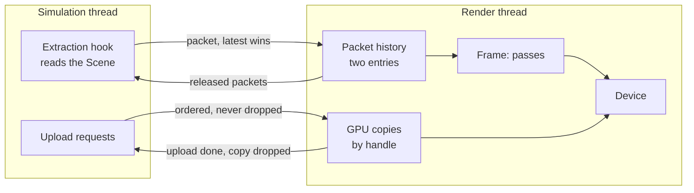
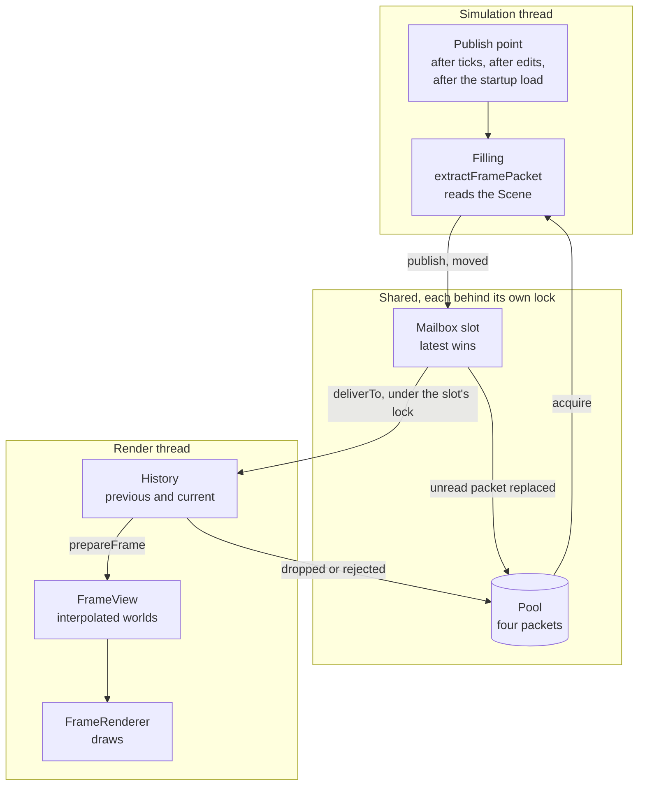
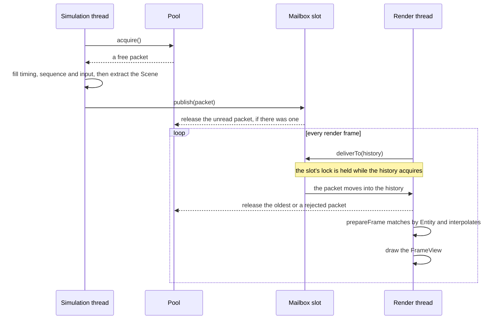
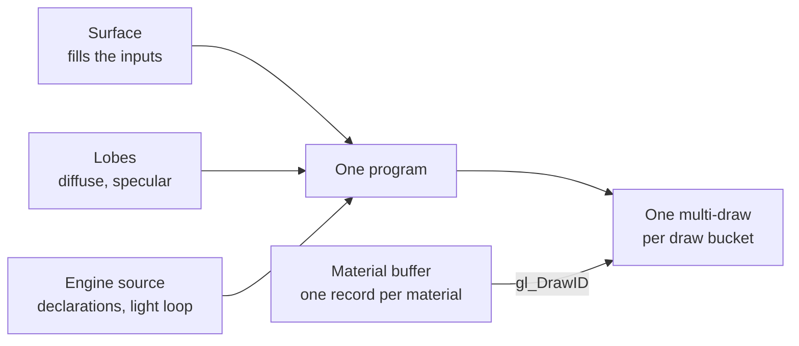

# Renderer: Design

> Living design doc. The decisions that are hard to reverse are in
> [[ADR-028 - Render device seam and frame packets]] (Accepted 2026-11-06) and
> [[ADR-029 - Materials, surfaces and lobes]] (Accepted 2026-11-10). This note holds the *how*,
> and it is R1's hub: plan and ground renderer work from here.

**Module:** `client` (the device, the passes, the render thread) · `apps/clientapp` and `app`
(the extraction hook) · `core` (mesh and material types)
**Kind:** system
**Status:** designed on 2026-11-06 (S10-D4) against engine `a67c4d4`; materials designed on
2026-11-10 (S10-D7) against `ac594e4`. The device is built (S11-T3, #207), and so are the frame
packets (S11-T4, #210); the frame still draws only M4's triangle
(`engine/client/src/render/FrameRenderer.cpp`).
**ADRs:** [[ADR-028 - Render device seam and frame packets]] ·
[[ADR-029 - Materials, surfaces and lobes]] ·
[[ADR-015 - Threading (sim on main, render thread owns GL)]] §2 ·
[[ADR-018 - Main and simulation threads, render-owned GL]] §2 ·
[[ADR-019 - Fixed simulation ticks, render interpolation and shared clock]] §3 ·
[[ADR-024 - Resources (64-bit ids, value handles, async loads)]] §6 ·
[[ADR-027 - Editor threads, edit commands and play sessions]] §1
**Product:** [[Renderer - Brief]] · **Research:** [[Renderer - Research Brief]],
[[Renderer - Seam Paper Report]], [[Renderer - Materials Paper Report]] ·
**Backlog:** [[Backlog]]

## Purpose

The renderer draws the `Scene` through a camera, the same way in the editor's scene view and
in the runtime. The `Scene` belongs to the simulation thread and GL to the render thread, so
the renderer is two halves: a hook that reads the `Scene` into a frame packet, and a frame on
the render thread that draws packets through a small device.

## Decided

| What | Call | Ref |
|---|---|---|
| A small device, shaped for GL | Typed handles, pipeline objects bound whole, explicit render passes. Passes never call GL. It executes immediately; there is no recorded command stream. | ADR-028 §1 |
| The scene view is a render target | The editor draws the same frame into a texture that ImGui shows. | ADR-028 §1; ADR-027 §1 |
| OpenGL 4.6 | The floor rises from 4.5. | ADR-028 §2 |
| Bindless textures are required | `ARB_bindless_texture`, with no fallback. Texture handles live in a material buffer that each draw indexes through `gl_DrawID`. | ADR-028 §2 |
| The frame packet | Read from the `Scene` after ticks and after applied edits; pooled and moved by ownership, never copied. ADR-019 §3's delivery and interpolation stand. | ADR-028 §3 |
| The extraction hook | `App::publishFrame(scene, simulation)` runs after a tick batch, after each applied batch of edits, and once after the startup load. `ClientApp` fills the packet through `FrameExtraction::extractFramePacket` in `client`. | Miguel, 2026-11-16 (S11-T4); § *The frame packet* |
| A packet at the same tick | Each packet carries a rising sequence. On the current timeline and tick, a newer sequence replaces the current packet and keeps the previous one; an older or equal one is dropped. | Miguel, 2026-11-16 (S11-T4); § *Packet delivery* |
| Matching instances across two packets | By `Entity`, generation included. An instance that appears draws at its current world, and one that vanishes is not drawn. From E2 render interpolates instance worlds and the camera on the CPU every frame. | Miguel, 2026-11-16 (S11-T4); § *Packet delivery* |
| The packet pool | Four packets, moved by `unique_ptr` and never destroyed. The render thread owns the pool. An empty pool is misuse and fires a check. | Miguel, 2026-11-16 (S11-T4); § *Packet delivery* |
| Handing a packet to the history | The mailbox runs the history's acquire while it holds its own lock, so render never holds a third packet. | Miguel, 2026-11-16 (S11-T4); § *Packet delivery* |
| Views | A frame draws one packet into one or more views, each with a target and a camera. The runtime has the window; the editor has its scene view and game view. A hidden view is not drawn. Light clusters depend on the camera, so each view builds its own. | ADR-028 §3 |
| The scene view's camera | It comes from main on ADR-019 §4's latest-value path, not from the packet, so it moves with no packet and no tick. The game view uses the scene's main active camera from the packet. | ADR-028 §3; [[Editor - Design]] § *The layout* |
| The camera component | `Camera` in `core`, registered in both apps like `MeshRenderer`. Perspective only in E2: a vertical field of view, near and far planes, ADR-029 §6's fixed exposure and a `main` flag. Its view comes from the entity's world transform. Orthographic is added when something needs it. | Miguel, 2026-11-14 (S10-D6) |
| The main active camera | A scene has at most one `Camera` with `main` set, and the game view and the runtime draw through it. With none, the view clears to a colour and the app warns once. | Miguel, 2026-11-14 (S10-D6); one at a time, Miguel, 2026-11-16 |
| How one main camera is kept | A `core` function sets a camera as main and clears `main` on every other `Camera`. Every caller goes through it: the editor's commands now, scripts from E11, so the runtime holds the rule too. A `Camera` added to a scene that already has a main camera is added with `main` off; the first camera in a scene is still main by default. Ticking `main` on several selected cameras at once is refused with a warning. Each camera it clears is part of the same edit, so one undo restores them all. | Miguel, 2026-11-16 |
| A scene with two main cameras | An old file, a hand edit or a merge can still bring two. Loading warns once, and the first in hierarchy order wins. The file stays as it is until the user fixes it and saves. | Miguel, 2026-11-16 |
| How the scene view's camera is driven | The scene view panel reads ImGui's mouse and keys on main and moves a fly camera: right mouse button to look, WASD to move. The `InputBuffer` stays detached while Stopped. Orbit and focus on the selection stay T3's. | Miguel, 2026-11-14 (S10-D6); [[Editor - Design]] § *Decided* |
| The device's surface | One handle type per kind, each an index and a generation. The vertex layout lives inside the pipeline. An empty target is the window. A bad description returns an error code; misuse fires a check. | Miguel, 2026-11-15 (S11-T3); § *The device* |
| The renderer is not a scheduled System | It is the extraction hook plus the render-thread frame. | ADR-028 §3, against ADR-006 §5 |
| Uploads cross in order | Mesh, texture and material uploads are never dropped. One GPU copy per resource handle. | ADR-028 §4 |
| Render's fence | Simulation defers a free until render reports the upload done. A reload keeps its handle and sends a new upload. | ADR-028 §4; ADR-024 §6 |
| The GPU copy's lifetime | Render drops a copy on a release request, once no packet in its history names the handle and the GPU has finished the frames that drew it. | ADR-028 §4 |
| E2's frame | Depth pre-pass, light clusters built and filled in compute as in v1, one forward lit pass with CPU-written multi-draws, sky, final image. | ADR-028 §5 |
| Compute from E2 | The device dispatches compute and binds storage buffers. A pass that writes in compute issues GL's coarse memory barrier through the device; per-resource barriers stay out. | ADR-028 §5 §6 |
| Shared geometry buffers | Static meshes share one set: a position buffer, an attribute buffer and a 32-bit index buffer. A new vertex layout gets its own set. A mesh never moves once placed. | ADR-028 §5; § *Geometry buffers* |
| Who owns the mesh | This note owns the GPU streams and attributes; `Content Pipeline - Design` (S10-D9) owns the file. | ADR-028 §5 |
| The vertex attributes | A normal (`float3`), a tangent (`float4`, `w` the bitangent's sign) and UV0 (`float2`), unpacked until measured. A stream a mesh lacks is filled with defaults at upload. Indices are 32-bit only. | S10-D10, 2026-11-09; ADR-028 §5; [[Content Pipeline - Design]] § *The mesh file* |
| A slot with no material entry | It draws with the mesh's default material. | S10-D10, 2026-11-09; [[Content Pipeline - Design]] § *Materials per slot* |
| One backend | No backend interface; Vulkan or D3D12 later replaces the device, not the passes. | ADR-028 §6 |
| A material is a surface and values | A surface is shader code that only fills inputs. A material is an asset in `core` that names one surface and stores its values. The standard material is the engine's own surface, and the only one in E2. | ADR-029 §1 |
| Surface, lobe, light loop | The engine owns the light loop and calls lobes. Its diffuse and specular are lobes from E2. Developers cannot add a lobe until a `/triage` opens the seam. | ADR-029 §2 |
| One lit model | Layers are always in the program and switched by values. A shading model value selects lit or unlit. | ADR-029 §3 |
| Postponed out of E2 | Clear coat, sheen and transmission. | Miguel, 2026-11-09; ADR-029 §3 |
| Draw buckets | Alpha mode (opaque, cut-out, blended) and double-sided are material state, and each combination has its own multi-draw. Cut-outs skip the depth pre-pass. | ADR-029 §4 |
| Shaders are GLSL source | The engine assembles one program per surface and lobe set from its own sources and the surface. No offline compiler, no SPIR-V. | ADR-029 §5 |
| Units | Photometric light values, and a fixed exposure on the camera until R2. | ADR-029 §6 |
| What the standard material samples | Base color, a packed occlusion, roughness and metallic map, a normal and emissive. Wrap and filter live on the texture asset. | ADR-029 §7 |
| Editing a material | Each edit is an undo step, and the file is written on Save. The asset edit path itself is not designed. | Miguel, 2026-11-09; [[Backlog]] § *editor & tooling* |
| The material file | A `.tematerial` is `MATERIAL_KIND` version 1: the id, the import block, the surface, the shading model, the alpha state, then each factor beside its texture, in glTF's terms. | S10-T23 (#203), 2026-11-13; § *The material file* |
| The material buffer | One 96-byte `std430` record per material: the factors, the cutoff, the shading model and four bindless handles. Alpha mode and sidedness pick the bucket, so they stay out of the record. | S10-T23 (#203), 2026-11-13; § *The material buffer* |
| A slot with a null material | It draws the engine's default material, record 0: opaque, lit, single-sided, white, roughness 1, metallic 0 and no textures. A material whose load failed draws it too. | S10-T23 (#203), 2026-11-13; § *The material buffer* |

## Design

### The device

Built by S11-T3 (#207) in `engine/client/src/render/device/`. Only the render thread calls it.
Its surface was settled at the card's `/card-start` (Miguel, 2026-11-15).

| Part | As built |
|---|---|
| Handles | One type per kind: buffer, texture, program, pipeline and render target. Each is an index and a generation, kept in a table per kind (`render/device/RenderSlots.hpp`). Destroying a slot raises its generation, so an old handle stops resolving; a slot at the generation limit is retired. |
| Data | One folder per kind holds its description, its enums and the record the device keeps. Every GL call is in `RenderDevice.cpp`. |
| Buffers | Immutable storage. A Static buffer takes all its data at creation; only a Dynamic one accepts `updateBuffer`. |
| Textures | `Rgba8`, `Rgba16F` and `Depth32F`, with no pixel upload until S11-T8. `readTexture` reads level 0, and `Rgba16F` comes back as 32-bit floats. |
| Pipelines | The program, the vertex layout with its strides, topology, cull, front face, depth and blend. `bindPipeline` applies all of it every time, and forgets the bound index buffer, because that lives in the pipeline's vertex array. |
| Render targets | One colour texture and an optional depth texture, which the target does not own. |
| Passes | An empty target is the window. The extent sets the viewport and the scissor, so a clear covers the extent only, and the scissor test is off again when the pass ends. Each pass starts with nothing bound. |
| Failures | A description the device cannot build returns a `ClientError` and creates nothing. Misuse, such as a stale handle, a draw outside a pass or a pass larger than its target, fires one `TE_CHECK` and returns before any GL call. |

- **Not built yet:** samplers and bindless handles (S11-T8), multi-draws and per-frame uniform
  buffers (S11-T9), and compute dispatch (the light clusters). Store actions are accepted and
  ignored, so `DontCare` does not invalidate anything yet.
- **A target needs a colour texture.** A depth-only target, which E3's shadow maps need, is
  refused today as `InvalidRenderDescription`.
- **The window's depth clear** runs whether or not the window has a depth buffer; without one,
  GL ignores it.

### The frame packet

Built by S11-T4 (#210, `4d0b8e0`, Nov 16). A packet is everything render needs from the `Scene` for one frame, with
handles and values only, never a pointer into the `Scene`
(`engine/client/include/TechEngine/client/render/FramePacket.hpp`).

| Field | Holds |
|---|---|
| Timing | The tick, its time, the fixed step and the timeline, as the snapshot carried them. |
| Sequence | A number that rises on every publish, so render can order packets that share a tick. |
| Input | The held input at the publish. |
| Instances | One per `MeshRenderer`: its `Entity`, its world matrix, its mesh handle, and a range of slots in the packet's material list. |
| Materials | One handle per slot, in slot order. A null handle is a slot with no material. |
| Camera | Whether the scene has a main active camera, and if so its settings and world matrix. |

- **Why it moves instead of being copied.** The snapshot was copied about four times per frame.
  A packet holds 64 bytes of matrix per instance, which is about 64 MB in E2b's stress scene.
- **Why it is published after edits and after the startup load.** A Stopped editor never ticks,
  so a packet sent only after ticks would never show an edit or the loaded scene.
- **Its vectors keep their capacity.** Extraction clears them without shrinking, and packets are
  never destroyed, so a warm frame allocates nothing.

### Packet delivery

Where each packet lives, and which thread moves it:

- **Four packets are enough:** one being filled, one in the slot and two in the history.
- **Render must never hold a third.** If render took the packet out of the slot and only then gave
  it to the history, it would hold three for a moment. Simulation could then publish into the
  empty slot and acquire from an empty pool. So the mailbox runs the history's acquire under its
  own lock, and simulation's publish waits on that lock for a few pointer moves at most.
- **The history's rules.** A new timeline replaces both entries. On the current timeline, a newer
  tick moves the current packet to previous, and a newer sequence at the same tick replaces the
  current packet in place. Anything older is dropped. Every packet it lets go returns to the pool.

### Packet delivery: the call order

- **The frame view is render's own.** `prepareFrame` fills a reused `FrameView` with one world
  per instance of the current packet, in the same order, and points it at that packet. The next
  acquire can free the packet, so the view is good for one frame only.

### Geometry buffers

| Buffer | Holds |
|---|---|
| Positions | Every static mesh's positions, 12 bytes each. |
| Attributes | Every static mesh's other attributes, interleaved: normal, tangent and UV0, 36 bytes. |
| Indices | Every static mesh's indices, 32-bit. |

One vertex array binds the two vertex buffers to two bindings.

- **Why positions are apart.** The depth pre-pass reads only positions, and from E3 so does
  every shadow pass. Interleaved, each vertex fetch would pull the whole vertex into the cache
  to use 12 bytes of it. All five engines in [[Renderer - Research Brief]] § *Q2 mapped* split
  them for the same reason. The gain is not measured on Sponza or Bistro.
- **One vertex index, two buffers.** A mesh's vertices sit at the same index range in both
  vertex buffers, so one `baseVertex` serves both streams.
- **Fixed size, immutable storage.** The set is created once with `glNamedBufferStorage`,
  sized at startup, and never resized. When it fills, a second block is added, and each block
  draws with its own multi-draw.
- **A free-list allocator, and meshes never move.** A freed range goes back to the list when
  render drops the mesh's GPU copy (ADR-028 §4), so no frame the GPU is still drawing reads it.
- **What v1 did, and why not again.** v1 grew its buffers by reallocating and copying them
  (`engine/client/src/renderer/mesh/VertexBuffer.cpp:100-108` at `v1-reference`). Removing a
  mesh copied the buffer's tail down over it and shifted every later mesh's offsets
  (`engine/client/src/renderer/resources/GpuResourceManager.cpp:99-112`). That costs a copy of
  the buffer per removal, and it moves offsets that frames still in flight use, which ADR-028
  §3's packets cannot allow.
- **Not in this set:** geometry the CPU rewrites each frame (debug lines, UI) gets its own
  streaming buffer, so it never fragments the static set.

### Materials

How a program is put together, from ADR-029 §1, §2 and §5:

- **A draw command** is one mesh slot with one material, and its instances. Commands are
  grouped by program, then by bucket.
- **The material buffer** holds one record per material, with the same layout for every
  material of one surface: the values, then a bindless handle per texture. An edit rewrites one
  record through ADR-028 §4's ordered channel. The standard surface's record is in § *The
  material buffer*.
- **An empty texture input** uses its factor alone.
- **Adding a layer later** (clear coat, sheen): new inputs that default to zero, new record
  fields, one lobe, and a version step of the material file.
- **A variant per layer set** stays possible behind the same files. If the layer tests measure
  too slow, the engine can compile a program for materials that leave a layer at zero. Unity,
  Unreal and Godot work this way from the start.

### The material file

Built by S10-T23 (#203) in `engine/core/src/material/Material.cpp`. A `.tematerial` is `MATERIAL_KIND`
at version 1, a binary blob like the texture. In order:

- **Its id, straight after the header**, for the asset index's 16-byte read.
- **The import block**, with the default settings.
- **The surface**, a `u8` that is always `Standard` in E2. A developer's surface is a new value.
- **The shading model** (`u8`: lit or unlit), **the alpha mode** (`u8`: opaque, cut-out or
  blended), **the cutoff** (`f32`, 0.5 by default) and **the double-sided flag** (`u8`).
- **Base color:** a `float4` factor, then its texture id.
- **Occlusion, roughness and metallic:** three `f32` factors (occlusion strength, roughness,
  metallic), then the packed texture's id, with occlusion in red, roughness in green and metallic
  in blue.
- **Normal:** an `f32` scale, then its texture id.
- **Emissive:** a `float3` factor, then its texture id.

A texture id of 0 is an empty input. The factors and their defaults are glTF's, so S10-T24 copies
a source material field by field: white base color, roughness and metallic 1, occlusion strength
and normal scale 1, emissive 0.

- **Read refuses** an unknown surface, shading model or alpha mode, a double-sided byte other
  than 0 or 1, and bytes after the emissive texture, each as `Malformed`. The factors are not
  range-checked.
- **The loader lists each non-null texture** in input order, once per input that names it, as the
  mesh's loader does with its default materials.
- **A layer later** (clear coat, sheen) appends its factors and textures and steps the version.

### The material buffer

The standard surface's record, one per material, in a `std430` storage buffer that each draw
indexes through `gl_DrawID`. It holds only what the shader reads:

| Offset | Field | Type |
|---|---|---|
| 0 | Base color factor | `vec4` |
| 16 | Emissive factor | `vec3` |
| 28 | Alpha cutoff | `float` |
| 32 | Occlusion strength, roughness, metallic, normal scale | 4 × `float` |
| 48 | Base color, packed ORM, normal and emissive handles | 4 × `uvec2` |
| 80 | Shading model, 0 lit or 1 unlit | `uint` |
| 84 | Padding to the record's 16-byte alignment | 3 × `uint` |

- **Handles are `uvec2`**, turned into a `sampler2D` in the shader, so the shader needs no 64-bit
  integer extension. A zero handle is an empty input, and the shader uses the factor alone.
- **Not in the record:** the alpha mode and the double-sided flag pick the draw bucket (ADR-029
  §4), and the surface picks the program.
- **The shading model is a value**, so an unlit material shares its bucket's multi-draw and the
  branch is uniform across each draw.
- **Record 0 is the engine's default material**, written by render at startup and never freed.
  A slot whose material is null or failed to load draws with it. It is visible and neutral, so a
  mesh imported before S10-T24 still shows; a missing material does not hide a mesh, and nothing
  flags it as an error.

### Build notes

Mechanism sections land as the build cards are cut. Known build work:

- **The GL floor is enforced at startup** (S11-T2, #206). glad2 loads 4.6 core with
  `GL_ARB_bindless_texture` (`external/glad/include/glad/gl.h` records the command), and the
  window requests a 4.6 core context (`engine/platform/src/window/Window.cpp:59-60`). The render
  thread starts only if `meetsGlRequirements` passes
  (`engine/client/src/render/RenderThread.cpp:94-99`). It takes what glad loaded as a
  `GlSupport` value and logs one error per missing requirement, so it is tested headless
  (`engine/client/tests/render/GlRequirementsTests.cpp`).
- **CI's software GL cannot meet the floor**, and only zink over lavapipe on Linux does,
  through an EGL context (ADR-028 § *Consequences*, S11-D1). On Linux the window uses EGL
  always, not only on CI, and the cases that draw or load GL are a `[gpu]` tier that CI runs on
  Linux only ([[ADR-008 - v2 build & testing baseline]]'s Nov 14 amendment, S11-D5).
- **The camera component** (S11-T5, #208, `4e05985`, merged Nov 16). `Camera` lives in
  `engine/core/include/TechEngine/core/camera/Camera.hpp`. The field of view is in degrees, the
  exposure is EV100 (the frame is scaled by `1 / (1.2 * 2^EV100)`, default 0), `main` defaults
  to true, and near and far default to 0.1 and 1000. `findMainCamera` takes the caller's
  warn-once flag and clears it when it finds a camera, so each view keeps its own flag. These
  were the lane's calls, listed in #208; Miguel merged it with none reversed.
- **One main camera per scene** (S11-T4, #210). `Camera::findMainCamera`, `setMainCamera` and
  `countMainCameras` are static members of `Camera`
  (`engine/core/src/camera/Camera.cpp`). The lookup counts main cameras with a const query
  and walks the tree through `getChildren` only when two or more tie, so a normal scene never
  walks. The inspector's `main` tick and the add-component command go through them
  (`apps/editor/src/edit/InspectorCommands.cpp`), and `SceneAsset::read` warns on two.
- **GPU captures** go through Nsight, since RenderDoc cannot capture bindless GL (Miguel, v1).
- **The light clusters follow v1's two dispatches:** one builds each cluster's bounds, one
  assigns lights. v1 ran both every frame and read the light count from the live `Scene`
  (`engine/client/src/renderer/passes/LightCullingPass.cpp:19-49` at `v1-reference`). Here the
  lights come from the packet, and the bounds depend only on the projection and the viewport,
  so they are rebuilt only when one of those changes.

## Open questions

- **A mirrored instance.** An entity whose world matrix has a negative determinant needs its
  front face flipped, and the front face is pipeline state, so one multi-draw cannot hold both.
  The lean is a second multi-draw for mirrored instances. A merged mesh has none, because import
  flips its triangles. Owner: R1's first frame card.
- **Whether instance interpolation moves to the GPU.** From E2 the CPU interpolates every
  instance each frame (§ *Decided*). The GPU could do it from both packets' buffers instead.
  Owner: E2b, measured against the stress scene.
- **How a world matrix is interpolated.** S11-T4 shipped a column-wise lerp of the matrix
  (`engine/client/src/render/PacketHistory.cpp`), which is exact for a translation but shrinks
  a mesh partway through a rotation. A slerp needs the packet to carry position, rotation and
  scale beside the matrix. The camera's field of view and planes follow the current packet, as
  shipped. Owner: the first card that shows something rotating, or E2b.
- **Orbit and focus on the selection** for the scene view's camera. The fly camera is decided
  (§ *Decided*). Owner: T3's viewport tools.
- **The anti-aliasing method** for the brief's smooth edges. MSAA suits forward shading.
  Owner: R1's first frame card.
- **The lit model's terms.** [[Renderer - Materials Paper Report]] § *What S10-D7 still has to
  decide* lists them, and ADR-029 leaves them here because they change no file. The leans, none
  of them decided: Lambert diffuse, the height-correlated Smith visibility term, energy
  compensation from the start because it shares the split sum's table, and a fixed 4%
  reflectance as glTF has. Owner: R1's lit pass card.
- **Which way a texture is sampled.** Import stores texture rows top row first with no flip,
  and stores UV0 as assimp gives it, so the shader or the upload must sample at `(u, 1 - v)` or
  flip the rows. The sky image follows the same rule ([[Content Pipeline - Design]] § *Texture
  rows and V*). Owner: R1's first frame card.
- **How the sky image becomes lighting:** the filtered levels for rough reflections and the
  diffuse light, built at load or at import. The file is one 2D `RGB9E5` image with ordinary mips
  ([[Content Pipeline - Design]] § *The sky image*). Owner: R1's sky card.
- **How a developer's surface declares its values,** and how a Script sets one on a single
  entity. Owner: the surface shader card, alongside E11.
- **Whether developers may write lobes.** The seam is internal. Owner: a `/triage`.
- **Where the project names the renderer's settings asset** ([[Resources - Design]] §
  *Open questions*, owner R1).
- **Whether lights go only to occupied clusters,** found from the depth pre-pass, or to every
  cluster as v1 did. With hundreds of lights, every cluster may be enough. Owner: E2b.
- **An ordered pass list or a render graph.** E2 needs only the list; ADR-013 §8's GPU zones
  attach to each pass either way.

## References

- M4's triangle and the snapshot path: `engine/client/src/render/`.
- The copies ADR-028 removes: `SnapshotMailbox.cpp:6`, `:14`; `SnapshotHistory.cpp:17-29`, `:42`.
- The publish points: `engine/app/src/SimulationThread.cpp:189-191`, `:211-214`, `:226-229`.
