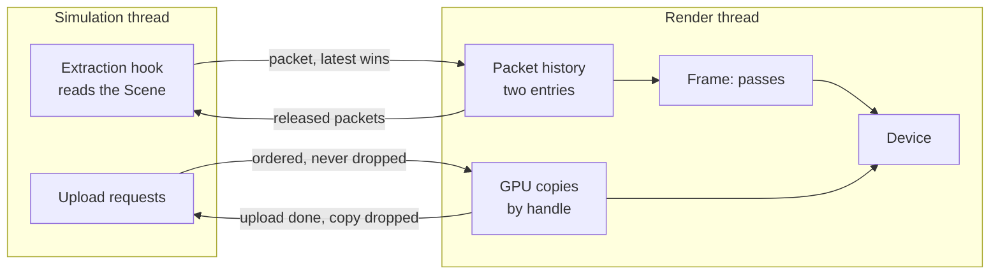
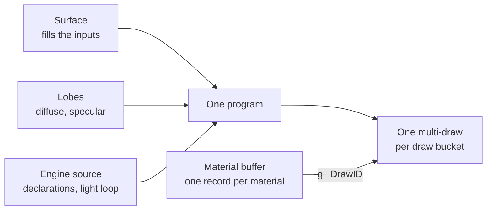

# Renderer: Design

> Living design doc. The decisions that are hard to reverse are in
> [[ADR-028 - Render device seam and frame packets]] (Accepted 2026-11-06) and
> [[ADR-029 - Materials, surfaces and lobes]] (Accepted 2026-11-10). This note holds the *how*,
> and it is R1's hub: plan and ground renderer work from here.

**Module:** `client` (the device, the passes, the render thread) · `apps/clientapp` and `app`
(the extraction hook) · `core` (mesh and material types)
**Kind:** system
**Status:** designed on 2026-11-06 (S10-D4) against engine `a67c4d4`; materials designed on
2026-11-10 (S10-D7) against `ac594e4`. Nothing is built
beyond M4's triangle (`engine/client/src/render/FrameRenderer.cpp`).
**ADRs:** [[ADR-028 - Render device seam and frame packets]] ·
[[ADR-029 - Materials, surfaces and lobes]] ·
[[ADR-015 - Threading (sim on main, render thread owns GL)]] §2 ·
[[ADR-018 - Main and simulation threads, render-owned GL]] §2 ·
[[ADR-019 - Fixed simulation ticks, render interpolation and shared clock]] §3 ·
[[ADR-024 - Resources (64-bit ids, value handles, async loads)]] §6 ·
[[ADR-027 - Editor threads, edit commands and play sessions]] §1
**Product:** [[Renderer - Brief]] · **Research:** [[Renderer - Research Brief]],
[[Renderer - Seam Paper Report]], [[Renderer - Materials Paper Report]] ·
**Backlog:** [[Backlog]]

## Purpose

The renderer draws the `Scene` through a camera, the same way in the editor's scene view and
in the runtime. The `Scene` belongs to the simulation thread and GL to the render thread, so
the renderer is two halves: a hook that reads the `Scene` into a frame packet, and a frame on
the render thread that draws packets through a small device.

## Decided

| What | Call | Ref |
|---|---|---|
| A small device, shaped for GL | Typed handles, pipeline objects bound whole, explicit render passes. Passes never call GL. It executes immediately; there is no recorded command stream. | ADR-028 §1 |
| The scene view is a render target | The editor draws the same frame into a texture that ImGui shows. | ADR-028 §1; ADR-027 §1 |
| OpenGL 4.6 | The floor rises from 4.5. | ADR-028 §2 |
| Bindless textures are required | `ARB_bindless_texture`, with no fallback. Texture handles live in a material buffer that each draw indexes through `gl_DrawID`. | ADR-028 §2 |
| The frame packet | Read from the `Scene` after ticks and after applied edits; pooled and moved by ownership, never copied. ADR-019 §3's delivery and interpolation stand. | ADR-028 §3 |
| Views | A frame draws one packet into one or more views, each with a target and a camera. The runtime has the window; the editor has its scene view and game view. A hidden view is not drawn. Light clusters depend on the camera, so each view builds its own. | ADR-028 §3 |
| The scene view's camera | It comes from main on ADR-019 §4's latest-value path, not from the packet, so it moves with no packet and no tick. The game view uses the scene's main active camera from the packet. | ADR-028 §3; [[Editor - Design]] § *The layout* |
| The renderer is not a scheduled System | It is the extraction hook plus the render-thread frame. | ADR-028 §3, against ADR-006 §5 |
| Uploads cross in order | Mesh, texture and material uploads are never dropped. One GPU copy per resource handle. | ADR-028 §4 |
| Render's fence | Simulation defers a free until render reports the upload done. A reload keeps its handle and sends a new upload. | ADR-028 §4; ADR-024 §6 |
| The GPU copy's lifetime | Render drops a copy on a release request, once no packet in its history names the handle and the GPU has finished the frames that drew it. | ADR-028 §4 |
| E2's frame | Depth pre-pass, light clusters built and filled in compute as in v1, one forward lit pass with CPU-written multi-draws, sky, final image. | ADR-028 §5 |
| Compute from E2 | The device dispatches compute and binds storage buffers. A pass that writes in compute issues GL's coarse memory barrier through the device; per-resource barriers stay out. | ADR-028 §5 §6 |
| Shared geometry buffers | Static meshes share one set: a position buffer, an attribute buffer and a 32-bit index buffer. A new vertex layout gets its own set. A mesh never moves once placed. | ADR-028 §5; § *Geometry buffers* |
| Who owns the mesh | This note owns the GPU streams and attributes; `Content Pipeline - Design` (S10-D9) owns the file. | ADR-028 §5 |
| The vertex attributes | A normal (`float3`), a tangent (`float4`, `w` the bitangent's sign) and UV0 (`float2`), unpacked until measured. A stream a mesh lacks is filled with defaults at upload. Indices are 32-bit only. | S10-D10, 2026-11-09; ADR-028 §5; [[Content Pipeline - Design]] § *The mesh file* |
| A slot with no material entry | It draws with the mesh's default material. | S10-D10, 2026-11-09; [[Content Pipeline - Design]] § *Materials per slot* |
| One backend | No backend interface; Vulkan or D3D12 later replaces the device, not the passes. | ADR-028 §6 |
| A material is a surface and values | A surface is shader code that only fills inputs. A material is an asset in `core` that names one surface and stores its values. The standard material is the engine's own surface, and the only one in E2. | ADR-029 §1 |
| Surface, lobe, light loop | The engine owns the light loop and calls lobes. Its diffuse and specular are lobes from E2. Developers cannot add a lobe until a `/triage` opens the seam. | ADR-029 §2 |
| One lit model | Layers are always in the program and switched by values. A shading model value selects lit or unlit. | ADR-029 §3 |
| Postponed out of E2 | Clear coat, sheen and transmission. | Miguel, 2026-11-09; ADR-029 §3 |
| Draw buckets | Alpha mode (opaque, cut-out, blended) and double-sided are material state, and each combination has its own multi-draw. Cut-outs skip the depth pre-pass. | ADR-029 §4 |
| Shaders are GLSL source | The engine assembles one program per surface and lobe set from its own sources and the surface. No offline compiler, no SPIR-V. | ADR-029 §5 |
| Units | Photometric light values, and a fixed exposure on the camera until R2. | ADR-029 §6 |
| What the standard material samples | Base color, a packed occlusion, roughness and metallic map, a normal and emissive. Wrap and filter live on the texture asset. | ADR-029 §7 |
| Editing a material | Each edit is an undo step, and the file is written on Save. The asset edit path itself is not designed. | Miguel, 2026-11-09; [[Backlog]] § *editor & tooling* |
| The material file | A `.tematerial` is `MATERIAL_KIND` version 1: the id, the import block, the surface, the shading model, the alpha state, then each factor beside its texture, in glTF's terms. | S10-T23, 2026-11-13; § *The material file* |
| The material buffer | One 96-byte `std430` record per material: the factors, the cutoff, the shading model and four bindless handles. Alpha mode and sidedness pick the bucket, so they stay out of the record. | S10-T23, 2026-11-13; § *The material buffer* |
| A slot with a null material | It draws the engine's default material, record 0: opaque, lit, single-sided, white, roughness 1, metallic 0 and no textures. A material whose load failed draws it too. | S10-T23, 2026-11-13; § *The material buffer* |

## Design

### Geometry buffers

| Buffer | Holds |
|---|---|
| Positions | Every static mesh's positions, 12 bytes each. |
| Attributes | Every static mesh's other attributes, interleaved: normal, tangent and UV0, 36 bytes. |
| Indices | Every static mesh's indices, 32-bit. |

One vertex array binds the two vertex buffers to two bindings.

- **Why positions are apart.** The depth pre-pass reads only positions, and from E3 so does
  every shadow pass. Interleaved, each vertex fetch would pull the whole vertex into the cache
  to use 12 bytes of it. All five engines in [[Renderer - Research Brief]] § *Q2 mapped* split
  them for the same reason. The gain is not measured on Sponza or Bistro.
- **One vertex index, two buffers.** A mesh's vertices sit at the same index range in both
  vertex buffers, so one `baseVertex` serves both streams.
- **Fixed size, immutable storage.** The set is created once with `glNamedBufferStorage`,
  sized at startup, and never resized. When it fills, a second block is added, and each block
  draws with its own multi-draw.
- **A free-list allocator, and meshes never move.** A freed range goes back to the list when
  render drops the mesh's GPU copy (ADR-028 §4), so no frame the GPU is still drawing reads it.
- **What v1 did, and why not again.** v1 grew its buffers by reallocating and copying them
  (`engine/client/src/renderer/mesh/VertexBuffer.cpp:100-108` at `v1-reference`). Removing a
  mesh copied the buffer's tail down over it and shifted every later mesh's offsets
  (`engine/client/src/renderer/resources/GpuResourceManager.cpp:99-112`). That costs a copy of
  the buffer per removal, and it moves offsets that frames still in flight use, which ADR-028
  §3's packets cannot allow.
- **Not in this set:** geometry the CPU rewrites each frame (debug lines, UI) gets its own
  streaming buffer, so it never fragments the static set.

### Materials

How a program is put together, from ADR-029 §1, §2 and §5:

- **A draw command** is one mesh slot with one material, and its instances. Commands are
  grouped by program, then by bucket.
- **The material buffer** holds one record per material, with the same layout for every
  material of one surface: the values, then a bindless handle per texture. An edit rewrites one
  record through ADR-028 §4's ordered channel. The standard surface's record is in § *The
  material buffer*.
- **An empty texture input** uses its factor alone.
- **Adding a layer later** (clear coat, sheen): new inputs that default to zero, new record
  fields, one lobe, and a version step of the material file.
- **A variant per layer set** stays possible behind the same files. If the layer tests measure
  too slow, the engine can compile a program for materials that leave a layer at zero. Unity,
  Unreal and Godot work this way from the start.

### The material file

Built by S10-T23 in `engine/core/src/material/Material.cpp`. A `.tematerial` is `MATERIAL_KIND`
at version 1, a binary blob like the texture. In order:

- **Its id, straight after the header**, for the asset index's 16-byte read.
- **The import block**, with the default settings.
- **The surface**, a `u8` that is always `Standard` in E2. A developer's surface is a new value.
- **The shading model** (`u8`: lit or unlit), **the alpha mode** (`u8`: opaque, cut-out or
  blended), **the cutoff** (`f32`, 0.5 by default) and **the double-sided flag** (`u8`).
- **Base color:** a `float4` factor, then its texture id.
- **Occlusion, roughness and metallic:** three `f32` factors (occlusion strength, roughness,
  metallic), then the packed texture's id, with occlusion in red, roughness in green and metallic
  in blue.
- **Normal:** an `f32` scale, then its texture id.
- **Emissive:** a `float3` factor, then its texture id.

A texture id of 0 is an empty input. The factors and their defaults are glTF's, so S10-T24 copies
a source material field by field: white base color, roughness and metallic 1, occlusion strength
and normal scale 1, emissive 0.

- **Read refuses** an unknown surface, shading model or alpha mode, a double-sided byte other
  than 0 or 1, and bytes after the emissive texture, each as `Malformed`. The factors are not
  range-checked.
- **The loader lists each non-null texture** in input order, once per input that names it, as the
  mesh's loader does with its default materials.
- **A layer later** (clear coat, sheen) appends its factors and textures and steps the version.

### The material buffer

The standard surface's record, one per material, in a `std430` storage buffer that each draw
indexes through `gl_DrawID`. It holds only what the shader reads:

| Offset | Field | Type |
|---|---|---|
| 0 | Base color factor | `vec4` |
| 16 | Emissive factor | `vec3` |
| 28 | Alpha cutoff | `float` |
| 32 | Occlusion strength, roughness, metallic, normal scale | 4 × `float` |
| 48 | Base color, packed ORM, normal and emissive handles | 4 × `uvec2` |
| 80 | Shading model, 0 lit or 1 unlit | `uint` |
| 84 | Padding to the record's 16-byte alignment | 3 × `uint` |

- **Handles are `uvec2`**, turned into a `sampler2D` in the shader, so the shader needs no 64-bit
  integer extension. A zero handle is an empty input, and the shader uses the factor alone.
- **Not in the record:** the alpha mode and the double-sided flag pick the draw bucket (ADR-029
  §4), and the surface picks the program.
- **The shading model is a value**, so an unlit material shares its bucket's multi-draw and the
  branch is uniform across each draw.
- **Record 0 is the engine's default material**, written by render at startup and never freed.
  A slot whose material is null or failed to load draws with it. It is visible and neutral, so a
  mesh imported before S10-T24 still shows; a missing material does not hide a mesh, and nothing
  flags it as an error.

### Build notes

Mechanism sections land as the build cards are cut. Known build work:

- **glad2** is regenerated with `--api gl:core=4.6` and `ARB_bindless_texture`
  (`cmake/deps.cmake:167`), and the startup check (`RenderThread.cpp:93`) names both
  requirements when one fails.
- **The packet pool** needs four packets for simulation never to wait: one being filled, one
  in the slot, two in render's history.
- **GPU captures** go through Nsight, since RenderDoc cannot capture bindless GL (Miguel, v1).
- **The light clusters follow v1's two dispatches:** one builds each cluster's bounds, one
  assigns lights. v1 ran both every frame and read the light count from the live `Scene`
  (`engine/client/src/renderer/passes/LightCullingPass.cpp:19-49` at `v1-reference`). Here the
  lights come from the packet, and the bounds depend only on the projection and the viewport,
  so they are rebuilt only when one of those changes.

## Open questions

- **A mirrored instance.** An entity whose world matrix has a negative determinant needs its
  front face flipped, and the front face is pipeline state, so one multi-draw cannot hold both.
  The lean is a second multi-draw for mirrored instances. A merged mesh has none, because import
  flips its triangles. Owner: R1's first frame card.
- **Where instance transforms are interpolated:** on the CPU per frame, or on the GPU from both
  packets' buffers. Owner: E2b, measured against the stress scene.
- **How render matches an instance across two packets** to interpolate it, for example by
  entity in a stable order, and what it does with one that appears or vanishes between them.
  Owner: R1's packet card.
- **How the editor's scene camera is driven** (orbit, fly, focus on the selection). Owner: T3's
  viewport tools. Presentation input while Stopped and which camera is the main active camera
  stay open in [[Editor - Design]] § *Open questions*.
- **The anti-aliasing method** for the brief's smooth edges. MSAA suits forward shading.
  Owner: R1's first frame card.
- **The lit model's terms.** [[Renderer - Materials Paper Report]] § *What S10-D7 still has to
  decide* lists them, and ADR-029 leaves them here because they change no file. The leans, none
  of them decided: Lambert diffuse, the height-correlated Smith visibility term, energy
  compensation from the start because it shares the split sum's table, and a fixed 4%
  reflectance as glTF has. Owner: R1's lit pass card.
- **Which way a texture is sampled.** Import stores texture rows top row first with no flip,
  and stores UV0 as assimp gives it, so the shader or the upload must sample at `(u, 1 - v)` or
  flip the rows. The sky image follows the same rule ([[Content Pipeline - Design]] § *Texture
  rows and V*). Owner: R1's first frame card.
- **How the sky image becomes lighting:** the filtered levels for rough reflections and the
  diffuse light, built at load or at import. The file is one 2D `RGB9E5` image with ordinary mips
  ([[Content Pipeline - Design]] § *The sky image*). Owner: R1's sky card.
- **How a developer's surface declares its values,** and how a Script sets one on a single
  entity. Owner: the surface shader card, alongside E11.
- **Whether developers may write lobes.** The seam is internal. Owner: a `/triage`.
- **Where the project names the renderer's settings asset** ([[Resources - Design]] §
  *Open questions*, owner R1).
- **Whether lights go only to occupied clusters,** found from the depth pre-pass, or to every
  cluster as v1 did. With hundreds of lights, every cluster may be enough. Owner: E2b.
- **An ordered pass list or a render graph.** E2 needs only the list; ADR-013 §8's GPU zones
  attach to each pass either way.

## References

- M4's triangle and the snapshot path: `engine/client/src/render/`.
- The copies ADR-028 removes: `SnapshotMailbox.cpp:6`, `:14`; `SnapshotHistory.cpp:17-29`, `:42`.
- The publish points: `engine/app/src/SimulationThread.cpp:189-191`, `:211-214`, `:226-229`.
