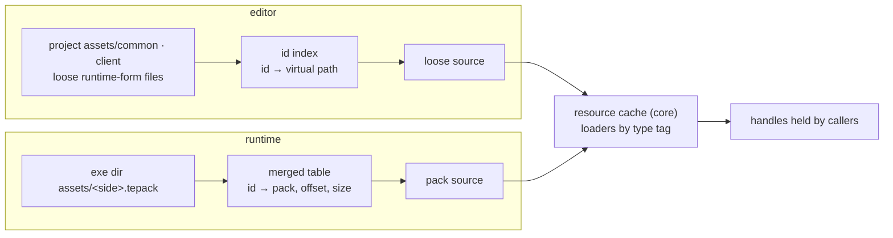
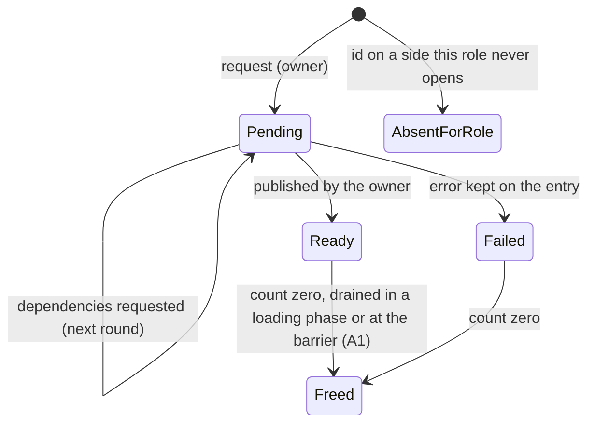
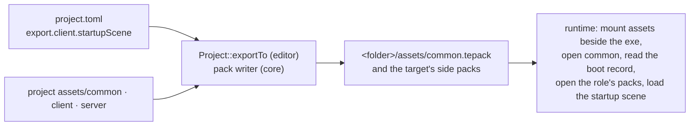

# Resources: Design

> Living design doc. The ADRs hold the decisions that are hard to reverse. This note holds the
> *how*, and it is the M6 hub: plan and ground M6 work from here.

**Module:** `core` (cache, loaders, pack reader and writer) · `apps/editor` (bake driver, id
index) · `client` (GPU mirror, from R1)
**Kind:** helper service (ADR-006 §5), not a scheduled System
**Status:** implementing. Both ADRs were **Accepted** on 2026-10-10. Built so far: `ResourceId`
and the scene asset (S8-T3, #127, 2026-10-11), the pack writer and reader (S8-T4, #128, 2026-10-11),
the boot record, `AssetSource` and the pack source (S8-T5, #129, 2026-10-11), and the editor's
`AssetIndex` and loose source (S8-T6, #131, 2026-10-12), the client export target (S8-T7,
#132, 2026-10-12), id generation with the editor's startup scene (S8-T13, #138, 2026-10-15),
the runtime's startup load (S8-T9, #139, 2026-10-15), the cache core (S8-T10, #141,
2026-10-18), and its loads on the `JobSystem` (S8-T11, #142, 2026-10-18).
**ADRs:** [[ADR-024 - Resources (64-bit ids, value handles, async loads)]] ·
[[ADR-025 - Content packs (.tepack and the runtime load path)]] ·
[[ADR-026 - Reference fields and scene-held acquires]] ·
[[ADR-006 - v2 core architecture & module layout]] §1 §4 ·
[[ADR-007 - v2 networking & ECS replication foundation]] §1 ·
[[ADR-016 - Serialization (binary primitives & describe-once seam)]] ·
[[ADR-017 - Bootstrapping (editor manifest, fixed runtime layout)]] ·
[[ADR-018 - Main and simulation threads, render-owned GL]] · [[ADR-023 - Public error handling]]
**Backlog:** [[Backlog]] → `core`

## Purpose

Resources is how the engine names, loads, shares and frees content. The editor works on loose
asset files under a project's `assets/`. The runtime loads `.tepack` files that hold the same
assets already in their runtime form. One id finds an asset in both places, loads run on the
`JobSystem`, and callers hold value handles that never dangle.

## Evidence and freshness

Drafted Oct 10, 2026, against engine `82d7a11c`, which the vault was reconciled against that
day. v1 citations refer to the `v1-reference` tag (`00e63207d24518b4e79a0d95ad2dd983e901aa13`);
read them with `git show v1-reference:<path>`. The v1 map was a static read; nothing was
built or run.

## Decided

### Decided: the resource model

| Fact | Where |
|---|---|
| An **asset** is content on disk, loose or packed; a **resource** is an asset loaded in memory. | ADR-024 §10 |
| Identity is a random 64-bit `ResourceId` in the asset's own header. Zero is null; a duplicate is an error. | ADR-024 §2 |
| The virtual path only locates, in the editor. The runtime never looks a resource up by path. | ADR-024 §2 |
| Every reference on disk is a `ResourceId`; loading remaps it to a handle. | ADR-024 §2 |
| Callers hold a generational handle that owns nothing. | ADR-024 §3 |
| The cache counts acquires per entry, not per copy; an entry holds acquires on its dependencies. | ADR-024 §3 |
| References live in data. A system reaches its own content through a settings asset; code never holds an asset id. | ADR-024 §4 |
| Hard references load only in a loading phase, while nothing ticks; a scene loads everything it hard-references. | ADR-024 §4 |
| A scene change acquires the new scene's references before releasing the old scene's. | ADR-024 §4 |
| Loads are asynchronous: pending, then ready or failed. A request fills a handle and returns a `std::error_code`. | ADR-024 §4, ADR-023 §2 |
| Reading and decoding run on the `JobSystem`; a task writes only its own entry, and a loader returns its dependencies instead of waiting. | ADR-024 §4 |
| The simulation thread owns the cache in the runtime and the editor; the editor's UI sends it load commands. Not on `EngineContext`. | ADR-024 §4 |
| Loader registration closes in `configureSimulation()`. | ADR-024 §4 |
| A failed startup load ends the run with its error; nothing substitutes a default. | ADR-024 §4 |
| Soft references load at any time: requested through a command buffer, loaded on the pool, published at the Tick barrier's last step. Built with A1. | ADR-024 §5 |
| Entry storage never relocates. Other threads read published copies or fenced data. | ADR-024 §6 |
| An id whose side this role never opens gets an absent-for-role entry, not an error. | ADR-024 §7 |
| Replicated components carry a `ResourceId`, never a handle. | ADR-024 §7, ADR-007 §2 |
| A scene is an entry with an id, streamed into the live `Scene`, never cached. | ADR-024 §8 |
| Scene components are framed by stable tag and byte length. Per-type versions land with T1's scene save. | ADR-024 §8 |
| Hot-reload swaps data behind a live handle; eviction is explicit release only. Both wait. | ADR-024 §9 |
| The cache is `ResourceCache`, owned by `App`; one instance holds every type behind its type tag. | ADR-024 §1 (amended Oct 18); § *The cache as built* |
| A reference cycle is invalid content: the loading phase rejects the edge that closes one. | Miguel, Oct 18; § *The cache as built* |
| A loading phase is two non-blocking halves, submit and drain, looped until nothing is pending or loading. A failure does not stop it; the phase returns the first error drained. | Miguel, Oct 18; § *Loads on the job system, as built* |
| The cache shuts down on the simulation thread right after `simulationShutdown()`, and again from its destructor. | Miguel, Oct 18; § *Loads on the job system, as built* |
| A loaded scene acquires each distinct id its components reference, once, and holds those acquires. A reference field owns nothing, so removing a component releases nothing. | ADR-026 §1 |
| An `Entity` field holds the live handle and saves its target's authoring row. An `AssetRef<T>` holds `{ResourceId, ResourceHandle<T>}` and saves the id. An empty field is valid. A replicated component holds a bare `ResourceId`. | ADR-026 §2 |
| One reference visitor over `visit` serves the scene writer, the reader's second pass, the scene's acquire set and the bake. The scene header has no dependency table. | ADR-026 §3 |
| A live `AssetRef<T>` names only an asset its scene holds. An editor edit acquires the new asset at once and releases the old one when the scene reloads. | ADR-026 §4 |
| The mesh is the second resource type. Before T4 the editor writes one in code, and until R1 it is loaded, not drawn. | Miguel, Oct 18; § *Reference fields* |
| A loaded scene is a cache entry, and its references are that entry's dependencies, so releasing the scene releases them. | ADR-024 §3 §8, Miguel, Oct 20; § *Reference fields* |
| Loading a scene through the cache is one `core` function, which every app's startup load calls with its own source. | Miguel, Oct 23; § *Reference fields* |

### Decided: packs and the runtime layout

| Fact | Where |
|---|---|
| A pack is a header, a table sorted by id, and 16-byte-aligned payloads. | ADR-025 §1 |
| A pack has its own magic and version, separate from scenes. Compression goes behind `flags`. | ADR-025 §2 |
| The bake ships only what its roots reach (exported scenes, systems' settings assets), hard and soft references alike, engine assets included. | ADR-025 §6 |
| A pack is never read whole: its table at open, each entry by a ranged read. `FileAccess` gains a byte-range read. Mappable later. | ADR-025 §3 |
| One pack per side; an id lives on exactly one side. | ADR-025 §4 |
| A pack reader in `core` on top of `FileAccess`, not an archive mount. | ADR-025 §5 |
| Writer and reader both in `core`, at M6; the bake driver stays in the editor. | ADR-025 §6 |
| The runtime mounts `assets` beside its executable and follows the boot record. | ADR-025 §7 |
| Shaders are client assets, under `assets/client/`. | Miguel, Oct 10; [[Project - Design]] |
| The export is an editor function per **export target**, a `Role` value. It writes one target into `<folder>/<project name>/assets/`, numbered `<name>(1)`, `<name>(2)` when that folder exists. Before T2, the editor exports the client target in its startup load, into its own executable folder. | Miguel, Oct 11, 12 and 15; § *Export targets* |
| The editor's engine folder is `<exe dir>/engine`, so `<exe dir>/assets` holds only packs. | Miguel, Oct 11; [[Project - Design]] |
| A source answers `Present`, `AbsentForRole` or `Unknown` through a query; only its `read` returns a `std::error_code`. | Miguel, Oct 11; § *Two sources, one cache* |
| An id missing from the role's packs but listed in the boot record's sides is absent for the role; in neither, it is unknown. | Miguel, Oct 11; § *The pack source* |
| A known boot section at a version the reader does not know is `BadVersion`; an unknown tag is skipped. | Miguel, Oct 11; § *The boot record* |
| The index knows an asset by its header's magic, paired with a `StringId` type tag; the tag is what the pack table stores and loaders register by. | Miguel, Oct 12; § *The editor's id index* |
| A file the index cannot read as a known asset is skipped with a warning; only a side folder that cannot be listed fails the index. | Miguel, Oct 12; § *The editor's id index* |
| A duplicate id is indexed under neither path, and the pair is kept as data (ADR-024 §2). | Miguel, Oct 12; § *The editor's id index* |

## v1 reuse boundary

The port/adapt/drop table is a decision, so it lives in
[[ADR-024 - Resources (64-bit ids, value handles, async loads)]] § *1. Port v1's identity;
replace its API*, with a `v1-reference` citation and a reason on every row.

## Design

### Two sources, one cache

The cache never touches a file path. It asks a **source** for an id's bytes, and the source
reads them through `FileAccess`. Both sources are real from M6, so this is an interface with
two implementations, on the `core` side. `FileAccess` stays a byte mover with no interface
([[File Access - Design]] § *Why there is no interface*).

The interface is `AssetSource`, in `engine/core/include/TechEngine/core/assets/`, named for what
it serves: asset bytes, not loaded resources (ADR-024 §10). `find(id)` returns an
`AssetAvailability` of `Present`, `AbsentForRole` or `Unknown`, and `read(id, out)` returns only
file and read failures. Reading an id that is not present is a `TE_CHECK`, so a caller asks
`find` first. Absence is a query result, not an error code, because ADR-023 §1 reports an
absence that is not a failure as data, and ADR-023 §2 gives `core` one error enum, `ReadError`.
An id the source answers `Unknown` for is `ReadError::UnknownResource`, a value S8-T10 added to
that same enum rather than opening a second one.

### The editor's id index

The editor builds its index at project open by reading the header of every runtime-form file.
It loads only from `common` and `client`, the sides a client mounts ([[Project - Design]] §
*The project layout*), and reads `server` headers only to record each id's side, so a
reference to a server asset is absent for the role rather than unknown. It scans each side
through `project://assets/<side>/`, not through the `assets` alias, because `list` returns only
the winning mount ([[File Access - Design]] § *`list` returns one mount*).

**Every asset is known; only what is used is loaded.** The index gives the content browser and
the reference pickers every asset's id, type, name and side from headers alone. An asset's data
loads on demand: the open scene's references, and whatever the inspector or a preview shows.
This is how Unity's AssetDatabase and Unreal's Asset Registry work. If on-demand loading is
ever measured as slow, the idle simulation thread can preload in the background while stopped.

A duplicate id, such as a file copied outside the editor, is reported at index time with both
paths. The index is not persisted, and rebuilding it on file changes waits for file watching
([[Backlog]] → `platform`).

**As built** (S8-T6, #131, 2026-10-12). `AssetIndex` lives in `apps/editor/src/assets/`, and
`EditorApp::init()` builds it right after the project mounts, with `TE_CHECK` on failure, like
the project load. Miguel settled these at `/card-start`:

- **An asset kind is a magic paired with a type tag.** The index reads the first 16 bytes (the
  header and the id) and looks the magic up in a table in `AssetIndex.cpp`. Scene is its only
  row, with `SCENE_TYPE_TAG` (`"TechEngine.Scene"`) beside `SCENE_KIND` in `SceneAsset.hpp`. A
  record holds the id, the type tag, the side and the virtual path, which is the "name" the
  pack's names block also stores.
- **Anything else is skipped with a warning**: a directory (silently), a file under 16 bytes,
  an unknown magic, a known kind at another version, a null id, or a file that fails to read.
  On `projects/dev` that is the `.gitkeep` files and the two raw GLSL shaders, until R1 makes
  shaders assets. Only a side folder that cannot be listed fails `build`.
- **A duplicate id is indexed under neither path.** Each extra path becomes a `DuplicateAsset`
  paired with the first, and a warning names both. The loose source then answers `Unknown`.
- **Records stay sorted by id**, and `find` is a binary search over them. `add` keeps that order
  (S8-T13): it inserts at the id's position and `TE_CHECK`s a null id, an id already indexed, and
  an id reported as a duplicate. `generateId` draws a random id and draws again on zero or on any
  of those ids. It reads two 32-bit values from `std::random_device`; a once-seeded `mt19937_64`
  was rejected, because a 32-bit seed would give two editor sessions the same id sequence.

The loose source is `LooseSource`, beside the index. It serves `common` and `client` and
reports a `server` id as `AbsentForRole`, so it takes no role. Nothing in Sprint 08's product
code calls it; its first caller is the cache (S8-T10, or Sprint 09's editor startup load), and
Miguel kept it here so the cache starts with both sources.

### Handles, counts and the load lifecycle

A handle is `{u32 index, u32 generation}`, typed per resource type and trivially copyable.
Resolving checks the generation, so a stale handle yields nothing. A slot keeps its generation
across reuse, as `Entity` slots do ([[Scene - Design]] § *Local entity handles*). Slots live in
fixed-size blocks that never move, which is what lets a fenced reader keep a pointer.

A request on the simulation thread finds or creates the entry and adds one to its count. An
unknown id fails at once. A new entry gets a `JobSystem` task that reads and decodes into that
entry's own payload slot, then pushes a completion naming the ids it depends on; the
completion queue's lock is the only lock a load task takes. The owner drains completions
during the loading phase: it publishes ready entries and requests dependencies as the next
round, until nothing is pending. `release` takes one off the count, and an entry at zero joins
a pending-free list drained in the next loading phase, or at the barrier's resource step once
A1 lands. A free waits only for the task of the entry being freed; an entry still loading
defers its free to a later drain, so a drain never stalls a Tick. At shutdown the owner waits
for every batch still in flight, which is legal because the simulation thread is not a pool
worker, and then logs every non-zero count.

The surface is `ResourceCache` (§ *The cache as built*), not `…System` (ADR-006 §5); ADR-006
§4's sketch had called it `ResourceRegistry`. `ResourceId` itself shipped early, at S8-T3,
because the scene header needs it: a strong `u64` type in
`engine/core/include/TechEngine/core/resources/ResourceId.hpp`, where zero is null. It has no
generator of its own: ids are created only in the editor, by `AssetIndex::generateId`
(§ *The editor's id index*, S8-T13).

### The cache as built

**As built** (S8-T10, #141, 2026-10-18), in `engine/core/{include/TechEngine/core,src}/resources/`.
`App` owns it and closes loader registration right after `configureSimulation()`. No product
code requests a resource yet, so the tests are its only caller. Miguel settled these at
`/card-start`:

- **One cache holds every type**, behind a `StringId` type tag, rather than a `ResourceCache<T>`
  per type. A handle is `ResourceHandle<T>`, the `{u32 index, u32 generation}` of ADR-024 §3;
  `resolve<T>` checks the tag, so a handle resolved as the wrong type is a `TE_CHECK`.
- **A loader registers under its asset's blob magic paired with its type tag**, and the cache
  picks the loader by the leading magic of the bytes it read. A dependency arrives as a bare id
  with no caller to name its type, and `AssetSource` serves only bytes, so the magic is the only
  thing that can choose. It is the pairing the editor's index already uses
  (§ *The editor's id index*). `registerLoader` takes the type as a template parameter, because
  the slot store needs its size, alignment and destructor.
- **A loader names its dependencies and never waits**: one hook, bytes in, payload out,
  dependency ids appended. Nothing writes a handle back into a payload until S8-D1 settles the
  reference field shape, so an entry records the dependencies it acquired and nothing more.
- **A payload is one allocation owned by its slot**, not a per-type pool. Only the slots have
  to stay put, and the blocks that hold them take 256 entries each.
- **Exhaustion and generation wrap are guarded** the way `EntitySlots` guards them: `create`
  `TE_CHECK`s the slot limit instead of handing out an index that reads as null, and a slot
  whose generation reaches its limit is retired rather than recycled.
- **A reference cycle is invalid content.** Counting cannot free one, so the loading phase
  rejects the dependency edge that would close a cycle with `ReadError::CyclicReference` and
  releases the acquire it had just taken. The alternative, a reachability collector, is what
  Unreal's GC does and what ADR-024 §3's counted entries rule out.
- **A null dependency id is a `TE_CHECK`**, not a skipped reference. An empty authored field is
  valid content (ADR-026 §2), but the reference walk skips it before any id reaches a loader's
  list, so the check stands.

### Loads on the job system, as built

**As built** (S8-T11, #142, 2026-10-18). The cache takes the `App`'s `JobSystem` at
construction, and `App` declares the job system first, so it outlives the cache. Miguel settled
these at `/card-start`:

- **A phase is two halves that never block.** `submitLoads()` turns every pending entry into
  one task in a single batch and marks it loading. `removeCompletions()` publishes what has
  finished and requests each completion's dependencies as pending entries for the next round.
  `runLoadingPhase()` loops submit, a wait on the in-flight batches, and the drain, until no
  entry is pending or loading, and then drains frees. The halves exist so that a test, and
  later A1's barrier step, can hold an entry in flight outside a phase.
- **A failed load does not stop the phase.** Every round still runs, each failure keeps its
  error on its own entry (`getError`), and the phase returns the first error it drained. A
  holder whose dependency fails to load stays Ready; a holder that names an unknown dependency
  id, or one that closes a cycle, fails itself.
- **A task touches only its own entry and the completion queue.** It writes the payload, the
  type tag and the error, then pushes a completion holding the slot and the dependency ids. It
  never looks an entry up through the slot store, because the owner grows that store while
  tasks run. The owner publishes the entry only when it drains the completion.
- **A free never waits.** `drainFrees` keeps an entry that is still loading, or that was
  acquired again, in the pending-free list for a later drain.
- **Shutdown runs after the app's own.** `SimulationThread` calls `ResourceCache::shutdown()`
  right after `app.simulationShutdown()`, so the app's releases land first and the log names
  only real leaks: it waits for every in-flight batch, then warns once per entry whose count is
  not zero. The destructor calls it again as a safety net for an App whose simulation never
  ran, and that second call logs the same entries again.

### Loading phases and other threads

| When | Thread | What happens |
|---|---|---|
| `configureSimulation()` | Main, before the simulation thread starts | Loaders register, then registration closes. |
| Startup loading phase | Simulation, after readiness, before the first Tick | The boot roots (startup scene, selected systems' settings assets) and everything they hard-reference load, then systems read their settings. The first Tick waits, and the timeline restarts after the phase so the load time is not replayed as catch-up ticks. A failure ends a runtime's run with its `std::error_code`; the editor reports it and stays open. The hook is `App::simulationStartupLoad()` ([[Simulation Thread - Design]] § *Lifecycle*). Until Sprint 09's editor load, the editor's override only creates or adopts its startup scene, then runs the startup export (S8-T13). |
| Scene change (T1 and later) | Simulation, with ticking stopped | Acquire the new scene's references, then release the old scene's, then drain frees. Shared content is never reloaded. |
| Editor load commands (T1) | Simulation, stopped or paused | Main's UI sends load commands through the main-to-simulation queue. A stopped or paused simulation does not tick, so each command runs as a loading phase; results come back as published copies. |
| Barrier resource step (A1) | Simulation | After structural commands and NetId assignment: issue the Tick's soft requests, publish finished loads, drain frees. Its order against the event step is A1's to fix. |
| `simulationShutdown()` | Simulation | The app releases what it holds; then the cache waits for its load batches and logs what is still counted (S8-T11). Nothing releases the leftovers. |

The startup load runs **after** readiness on purpose. `SimulationThread::start` blocks main
until the thread signals ready (`engine/app/src/SimulationThread.cpp:50`), so a load inside
`simulationInit()` would freeze main's event pump.

A system never acquires or releases from `tick`, though it may resolve ready entries on any
thread. Hard references are already loaded, and a soft request goes into a request list the
executor owns beside each system's structural buffer. The list is discarded with that buffer on
a failed Tick and merged in graph order at the barrier, so `Scene` never applies resource
requests and P1 moving systems onto workers cannot race the cache. Only the simulation thread creates, publishes and
frees entries; a load task writes only its own entry's payload. Main and render read only
copies the simulation published, or data pinned behind a fence that a free waits for. R1 adds
render's fence and T1 adds main's; M6 has neither.

### Settings assets

A system that needs content of its own, such as R1's renderer and its shaders, gets it from a
**settings asset**: an ordinary asset holding that system's configuration and hard references,
edited in the inspector. A system names it at startup registration, which runs on main before
the cache's owner exists, and reads it after the startup loading phase has published it,
before its first Tick. Unity's Graphics settings and render pipeline asset are the same idea.
The bake walks it like a scene, and the boot record lists each selected system's settings asset,
keyed by the system's registration name, as roots the startup phase loads.

### Scene assets

A scene asset is a `.tescene` file under the side that ships it: `assets/common/` for a scene
every export target opens, or one side's folder for a scene only that program opens, such as a
client's menu (§ *Export targets*).
It shipped at S8-T3 (#127, 2026-10-11) in
`engine/core/include/TechEngine/core/scene/SceneAsset.hpp`. Since S8-T5 it is a `SceneAsset`
struct that holds the asset's `ResourceId`, with `write(scene, out)` and `read(bytes, scene)`;
before that it was two free functions, which Miguel removed because a type's operations are its
members. The code says "scene asset" where earlier notes and cards said "scene document",
following ADR-024 §10's vocabulary.

| Part | Content |
|---|---|
| Header | `SCENE_KIND` (magic "TESC", version 1), then the scene's `ResourceId` as a `u64` |
| Entity count | `u32` |
| Per entity | Authoring id (`u32`, equal to its row; ADR-007 §1), parent row (`u32`, `0xFFFFFFFF` for a root), block count (`u32`), then that entity's blocks |
| Per block | Stable tag (`u64`), byte length (`u32`), then the visited payload |

- **Rows list parents before children, and children in sibling order**, so the reader appends
  each child and child order survives. Root order is not kept; it is not a contract.
- **Every count comes before what it counts**, so any truncation is detected as `Truncated`.
- **A component is written when its type has a `visit` for both archives.** Registration fills
  the record's adapters automatically. `Hierarchy` has none, so it is rebuilt from parent rows.
- **A block with an unregistered tag is skipped with a warning.** Keeping it as raw bytes for
  the next save moved to Sprint 09 with T1's scene save. A registered block whose payload does
  not consume exactly its length is also skipped with a warning; until T1 adds per-type
  versions, its data is lost on the next save.
- **The reader takes an empty `Scene` and leaves it empty on any failure.** A table that breaks
  the row rules (an id that is not its row, a parent that is not an earlier row, bytes after
  the last entity) is `ReadError::Malformed`. `SceneAsset::id` is set only on success.
- Entity references in a payload are authoring rows, and asset references `ResourceId`s;
  loading remaps both in a second pass (§ *Reference fields*). Nothing writes either yet.

### Reference fields

Decided on Oct 18 at S8-D1 ([[ADR-026 - Reference fields and scene-held acquires]], Accepted Oct 19).
Not built: Sprint 09's cards build it.

| Job | What the reference walk does |
|---|---|
| Scene write | Maps each `Entity` to its row; writes each `AssetRef<T>` as its id |
| Scene read, second pass | After the last row: maps rows to entities. After the loading phase: fills each `AssetRef<T>` handle |
| Scene load | Collects the distinct ids, which the loaded scene acquires once each |
| Bake | Collects the ids each root scene reaches, so only those are packed |

- **The lifecycle.** The startup load and every later scene change acquire the new scene's ids
  before releasing the old scene's (ADR-024 §4), so content the two share never reloads. Nothing
  else releases a scene's acquires.
- **Where the acquires live** (decided Oct 20, at S8-D2). The scene is an entry in the cache. Its
  loader keeps the file's bytes as the payload and names no dependencies, because a load task
  cannot touch the live `Scene`. On the simulation thread, after the loading phase publishes the
  entry, the load streams the bytes into the live `Scene` and frees them, so no parsed copy is
  kept (ADR-024 §8). It then walks the live scene and adds each distinct id as a dependency of
  the scene entry, through a call only the owner makes, and runs another loading phase.
  Releasing the scene entry releases its references, and the cycle check and the shutdown log
  cover them unchanged. Keeping the set beside the live `Scene` was rejected: it would repeat the
  cache's dependency bookkeeping outside it, and it needs a release that takes no type.
- **One load for every app** (decided Oct 23, at S8-D4). The steps above, from the request to
  filling the handles, are one function in `core`, because the cache, the scene asset and the
  live `Scene` all live there. The runtime calls it with its `PackSource` as the cache's source,
  the editor with its `LooseSource`, and a dedicated server will call it too, so it cannot live
  in `ClientApp`. Copying the steps into each app was rejected: the copies would drift. Its name
  and header are Sprint 09's first reference card's to settle.
- **The editor.** An inspector edit runs as a loading phase: it acquires the new asset and fills
  the field. The asset it replaced stays held until the scene reloads (T1).
- **The mesh.** It is Sprint 09's second resource type, because the hard-coded triangle in
  `engine/client/src/render/FrameRenderer.cpp` is its consumer. Until T4's importers, the editor
  writes a mesh asset in code, the way S8-T13 writes the startup scene. Until R1 it is loaded and
  never drawn; tests and a runtime log line prove the load. Drawing it needs render's fence and
  a GPU copy keyed by handle, which are R1's. Its payload is a placeholder with the triangle's
  shape: R1's renderer ADR owns the mesh format and replaces it, which costs only a blob version
  bump, because the editor regenerates the mesh on every run.

### Pack layout and the boot record

| Part | Content |
|---|---|
| Header | `PACK_KIND` (magic "TEPK", version 1) with `flags` (compression later), the entry count (`u32`), then the boot record's offset and size (`u64` each, both zero when there is none). 28 bytes. |
| Table | Per entry, sorted by id: `ResourceId`, type tag (`u64`), offset (`u64`), size (`u64`), name offset (`u32`). 36 bytes, so row `k` is found without reading the rows before it. |
| Names | The source virtual path of each entry, as a debug label: a `u32` length and the bytes. A name offset counts from the start of this block. |
| Payloads | Each at a 16-byte-aligned absolute offset, with zero padding between. In-place use assumes the buffer a ranged read fills is itself 16-byte aligned, which default `new` gives on every current target. |
| Boot record | In `common.tepack` only, at the next 16-byte boundary after the last payload. |

The pack header points to the boot record, so no reserved id exists; its format is
§ *The boot record*. `ReadError` already covers a bad magic or version; the serialization change
to per-kind magic and version is [[Serialization - Design]]'s.

### The boot record

The boot record is a list of tagged sections, so a runtime skips a section it does not know
and an older runtime still starts. It is `BootRecord` in
`engine/core/include/TechEngine/core/resources/BootRecord.hpp`, which writes and reads itself
(`write`, `read`). It starts with a `u32` section count, so a cut at a section boundary is still
`Truncated`. Each section is a `StringId` tag, a `u16` version (1 for all four) and a `u32` byte
length, then its payload. This table is the one home for the section list; adding a row needs
no ADR amendment (ADR-025 §7).

| Section | Tag | Payload | Since |
|---|---|---|---|
| Startup scene | `TechEngine.Boot.StartupScene` | The scene's `ResourceId` (`u64`) | M6 |
| System settings | `TechEngine.Boot.SystemSettings` | A `u32` count, then per selected system its registration name (a string) and its settings asset's `u64` id. Written with a count of zero until R1. | M6 (first used by R1) |
| Packs per role | `TechEngine.Boot.RolePacks` | A `u32` count, then per role a `u8` `Role`, a `u32` count and the file names of the packs it opens | M6 |
| Sides | `TechEngine.Boot.Sides` | A `u32` count, then per id its `u64` value and a `u8` `Side` (`core/resources/Side.hpp`) | M6 |

- **An unknown tag is skipped by its length**, with a warning, before its version is read.
- **A known tag at another version is `BadVersion`.** Skipping it would turn a newer
  startup-scene section into a confusing "no startup scene" error later.
- **A known payload that does not fill exactly its length is `Malformed`**, and so is a `Role`
  or `Side` byte outside its enum or a null id in the sides. Scene blocks are skipped instead,
  because they have no per-type version yet. The writer asserts on a null id in the sides.
- **`read` assigns the record only on success.** A duplicate known section is not rejected,
  because the writer cannot produce one.

### Pack writer and reader

The writer and reader shipped at S8-T4 (#128, 2026-10-11). Since S8-T5 their declarations are
split by job in `engine/core/include/TechEngine/core/resources/`: `PackFormat.hpp` holds the
kind, sizes and alignment, `PackReader.hpp` holds `PackReader` and `PackEntry`, and
`PackWriter.hpp` holds `PackWriter` and `PackInput`, so each `.cpp` pairs with its header.
`PackReader::getEntries()` was added at S8-T5 for the pack source's merge. Miguel settled these
at S8-T4's `/card-start`:

- **`PackWriter` builds the pack in memory**, and the bake writes it with `FileAccess::write`.
  `add` keeps the caller's views, so payloads must outlive `write`; a null or duplicate id is a
  `TE_CHECK` in `add`, because S8-T6's index already reports duplicates as data errors.
- **`PackReader::open` checks everything at open**, so a bad pack fails once and never during a
  load: ids non-null and strictly ascending, offsets aligned, and every payload and the boot
  range after the table and inside the file. A failure is `ReadError::Malformed`, a file shorter
  than its header or table is `Truncated`, and any other file error comes back unchanged. The
  reader is left empty on any failure. It never reads the names.
- **An absent id is `find` returning `false`**, because `core` owns only `ReadError` and none of
  its codes means "not here". `bootRecord` returns the boot range as a `PackEntry`, and `read`
  serves both with one ranged read.

### The pack source

`PackSource`, in `engine/core/include/TechEngine/core/assets/`, is the runtime's `AssetSource`.
One `PackReader` reads one file; one `PackSource` serves everything a role can see, so the cache
holds one source in either process.

- **`open(record, role, directory)` opens the packs the record lists for that role**, each at
  `directory` plus its name (`assets://common.tepack`), and merges their tables into one table
  sorted by id: id to pack, offset and size. It also keeps the sides' ids, sorted.
- **`open` returns `Malformed` when the record does not list the role**, or when two opened packs
  hold the same id (a bake error, ADR-025 §4). A pack's file error comes back unchanged. It builds
  into locals and starts by clearing, so the source is empty after any failure.
- **`find` checks the merged table first, then the sides.** The order matters, because the sides
  list every id, the role's own included. The cost: a common id that a bake wrongly leaves out
  of `common.tepack` reads as absent for the role, not as an error.
- **`read` is one ranged read through the id's own pack**, so nothing is read at open beyond the
  headers and tables.

### Export and the runtime layout

Each export target's startup scene is a key in `project.toml`; [[Project - Design]] owns the
schema. The export walks hard and soft references from the target's roots, its startup scene and
the selected systems' settings assets (in M6, the startup scene alone), and packs only what they
reach, each asset into its side's pack. Engine-owned assets the editor keeps
beside its executable travel the same way, so the runtime needs no `engine` alias and F27's
copy-per-project problem does not return: the bake copies only into the shipped pack. M6's bake
packs files as they are, because every M6 asset is engine-native. T4 adds importers that write
runtime-form files first, and the bake does not change.

**The export is a function, and its trigger changes with the rungs** (decided Oct 11).
`Project::exportTo` takes an export target, the id index and an output folder. T2's export
command will call it; until then the editor exports the client target once in its startup
load (S8-T13), after its startup scene exists, and logs a failure without stopping. A command-line mode was considered and dropped: the shipped editor calls the function
from its UI, so parsing flags would be code nothing keeps. Unity is the same shape: its build
menu and `-executeMethod` both call `BuildPipeline.BuildPlayer`. The output defaults to the
editor's own executable folder. Both executables build into one `${CMAKE_BINARY_DIR}/bin`
(`CMakeLists.txt:29`), and the editor's engine folder moved from `<exe dir>/assets` to
`<exe dir>/engine`, matching its alias, so `assets/` there was free for packs.

**Since S8-T13 the packs no longer land beside `runtime`.** `exportTo` writes into
`<folder>/<project name>/assets/` (§ *Export targets*), so the development export lands in
`bin/<config>/Dev/assets/`, or `Dev(1)` and later once `Dev` exists, and every editor launch adds
a folder. Until the export command decides that layout, the runtime reads the first one,
`<exe dir>/Dev` (§ *The runtime's startup load*).

### The runtime's startup load

Built at S8-T9 (#139, 2026-10-15) as `RuntimeApp::simulationStartupLoad()` in
`apps/runtime/src/RuntimeApp.cpp`. It reads the scene directly, without a cache, because no
cache existed yet. S8-T10 has since built one (§ *The cache as built*), and routing this path
through it is a [[Backlog]] entry with no card. Miguel settled these at `/card-start`:

- **`RuntimeApp` takes a folder and mounts `<folder>/assets` in `init()`**, through a protected
  `mountAssets()` that the headless tests call, since `init()` also opens the window. `main`
  passes `<exe dir>/Dev`, the dev project's first export, and ignores `Dev(1)` and later. This
  is a development stopgap against ADR-025 §7, which still says `<exe dir>/assets`.
- **The order:** open `assets://common.tepack`, read its boot record, `PackSource::open` the
  client's packs at `assets://`, then `find` and `read` the startup scene into the live scene.
- **A missing or broken file returns its own error unchanged** (`FileError::NotFound`,
  `ReadError::Truncated`). **A missing startup scene is `ReadError::Malformed`**: a
  `common.tepack` with no boot record, a null startup-scene id, or an id the client's packs do not
  hold. No error enum outside the editor means "not here", and these are all export errors.
- **`find` must say `Present` before `read`**, because `PackSource::read` asserts on any other id.
- After a successful load, the runtime logs the scene's tree with each entity's local position,
  because nothing draws entities yet.

### Export targets

An export target is a program the user ships: the client game, a dedicated server or a
listen-server (decided Oct 12). It is a `Role` value, so no second enum exists. Each target has
its own startup scene, because a client may start in a menu while a server starts in the world.
Unreal splits *Game Default Map* from *Server Default Map* for the same reason, and Unity's
build profiles each carry their own scene list (both from memory).

| Target | Packs written | Boot record lists |
|---|---|---|
| Client | `common`, `client` | Client |
| Dedicated server | `common`, `server` | DedicatedServer |
| Listen-server | `common`, `client`, `server` | ListenServer |

- **`exportTo` writes one target into `<folder>/<project name>/assets/`**: only that target's
  packs, with the boot record in its `common.tepack`. When `<project name>` already exists in the
  folder, it writes `<project name>(1)`, then `(2)`, and so on, and it never writes into an existing
  folder. The name is chosen only after the startup scene is validated, so a failed export claims
  no folder. Miguel added the project folder at S8-T13 (#138, 2026-10-15). The project folder is a
  complete layout once a runtime executable sits beside its `assets/` (T5).
- **Several targets are T2's job.** Each export claims its own project folder today, so a second
  target exported into the same folder would become `<project name>(1)`. T2 decides how a target
  appears in the folder name.
- **The startup scene must be on a side the target ships.** A client target whose scene is a
  server asset fails the export, because the client could never open it.
- **Built at S8-T7 for the client target only** (#132, 2026-10-12), as `Project::exportTo` in
  `apps/editor/src/project/Project.cpp`. A table lists which sides each target ships, and the two
  server rows sit commented out until a server executable or hosting exists. A missing, unindexed
  or unshipped startup scene returns `NoStartupScene`, `UnknownStartupScene` or
  `StartupSceneNotInTarget`; a target missing from the table is a `TE_CHECK`.

### What later rungs inherit

| Rung | Uses |
|---|---|
| **R1** | Mesh, shader and material loaders; a GPU mirror keyed by handle; render's read fence. |
| **T1** | Scene save through the document writer; per-type component versions; main's read fence; opening another scene during a run. |
| **T2** | The editor's save and export commands, on top of `exportTo`; the export command writes each chosen target into its own subfolder. |
| **T4** | Importers that write runtime-form files, and the sidecar-or-registry choice for source ids. |
| **T5** | The runtime executable plus `assets/`, as a distributable. |
| **P1** | Soft loads share the pool with the parallel executor; priorities if one delays a Tick. |
| **A1** | Soft references: the field type, the command-buffer request, and the Tick barrier step. |
| **N3** | Replicated components carry `ResourceId`s, never handles (ADR-007 §2). |

## Open questions

- **How the runtime reaches the exported folder.** The development export lands in
  `bin/<config>/<project name>(n)/assets/`, not in `<exe dir>/assets/`, where ADR-025 §7 has the
  runtime look. S8-T9 hard-coded `<exe dir>/Dev` as a stopgap (§ *The runtime's startup load*).
  Copying the runtime into the export folder, or a development-only path argument, are the
  candidates, and the answer may amend ADR-025 §7. Owner: T2, with T5's distributable.
- **Whether `PackReader::open` rejects non-zero `flags`.** Today it ignores them, so a future
  compressed pack would be read as raw bytes. Owner: whoever adds compression behind `flags`.
- **The editor's stopped, playing and paused states.** Decided Oct 10: only Play ticks; stopped
  and paused do not, and the simulation thread stays alive and idle between commands. Today every
  App ticks from the end of the startup phase until stop (`engine/app/src/SimulationThread.cpp:188-200`), so the
  idle state and a wake on command arrival are T1's to build in [[Simulation Thread - Design]].
- **Changing scene during a run**, and whether that ends an ADR-022 simulation session. The
  cache lives per process either way (ADR-024 §4). M6 loads only the startup scene. Owner: T1.
- **Where the project names each system's settings asset.** Likely one entry per selected
  system, which the bake copies into the boot record. Owner: R1, the first engine system with
  content of its own.
- **How a system holds a soft reference and learns it is ready.** Owner: A1.
- **Sidecar or registry for an imported source's id.** Owner: T4.
- **What a listen-server opens.** Probably all three packs. Owner: netcode, with
  [[Project - Design]] § *Open questions*.
- **Whether `Window` outlives a project reload** ([[Window - Design]] § *Open questions*) stays
  open: M6 loads one project per process and never swaps it.

## References

- [[v1 Code Audit]]: F7, F13, F23, F30, F31.
- [[Lessons from v1 (reference prototype)]]: the Resources row, "redesign API, port the UUID and
  cache model".
- [[Serialization - Design]]: `Writer`, `Reader`, `visit`, and § *Composing with `FileAccess`*.
- [[Project - Design]]: the asset split, the mount set and the editor's `engine` alias.
- [[Scene - Design]]: the single live `Scene` and its reference-remapping gate.
- [[Concurrency - Design]]: the pool the load tasks run on.
- Code at `82d7a11c`: `engine/core/include/TechEngine/core/EngineContext.hpp:8-12`,
  `engine/core/include/TechEngine/core/scene/Entity.hpp:10-22`,
  `engine/core/include/TechEngine/core/jobs/JobSystem.hpp`,
  `apps/runtime/src/RuntimeApp.cpp:27-34`.
