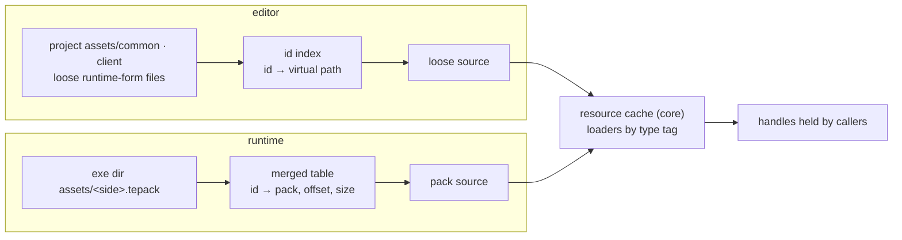
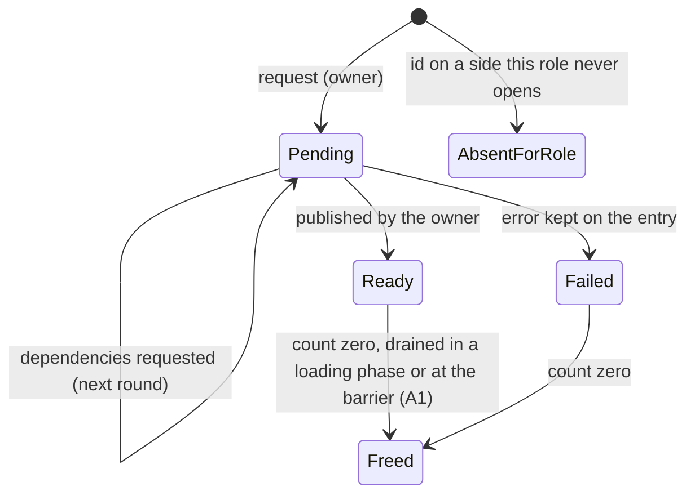
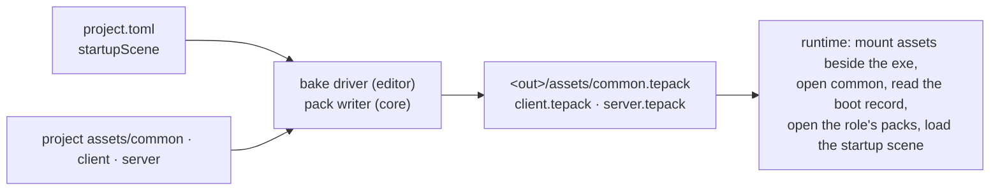

# Resources: Design

> Living design doc. The ADRs hold the decisions that are hard to reverse. This note holds the
> *how*, and it is the M6 hub: plan and ground M6 work from here.

**Module:** `core` (cache, loaders, pack reader and writer) · `apps/editor` (bake driver, id
index) · `client` (GPU mirror, from R1)
**Kind:** helper service (ADR-006 §5), not a scheduled System
**Status:** implementing. Both ADRs were **Accepted** on 2026-10-10. Built so far: `ResourceId`
and the scene asset (S8-T3, #127, 2026-10-11).
**ADRs:** [[ADR-024 - Resources (64-bit ids, value handles, async loads)]] ·
[[ADR-025 - Content packs (.tepack and the runtime load path)]] ·
[[ADR-006 - v2 core architecture & module layout]] §1 §4 ·
[[ADR-007 - v2 networking & ECS replication foundation]] §1 ·
[[ADR-016 - Serialization (binary primitives & describe-once seam)]] ·
[[ADR-017 - Bootstrapping (editor manifest, fixed runtime layout)]] ·
[[ADR-018 - Main and simulation threads, render-owned GL]] · [[ADR-023 - Public error handling]]
**Backlog:** [[Backlog]] → `core`

## Purpose

Resources is how the engine names, loads, shares and frees content. The editor works on loose
asset files under a project's `assets/`. The runtime loads `.tepack` files that hold the same
assets already in their runtime form. One id finds an asset in both places, loads run on the
`JobSystem`, and callers hold value handles that never dangle.

## Evidence and freshness

Drafted Oct 10, 2026, against engine `82d7a11c`, which the vault was reconciled against that
day. v1 citations refer to the `v1-reference` tag (`00e63207d24518b4e79a0d95ad2dd983e901aa13`);
read them with `git show v1-reference:<path>`. The v1 map was a static read; nothing was
built or run.

## Decided

### Decided: the resource model

| Fact | Where |
|---|---|
| An **asset** is content on disk, loose or packed; a **resource** is an asset loaded in memory. | ADR-024 §10 |
| Identity is a random 64-bit `ResourceId` in the asset's own header. Zero is null; a duplicate is an error. | ADR-024 §2 |
| The virtual path only locates, in the editor. The runtime never looks a resource up by path. | ADR-024 §2 |
| Every reference on disk is a `ResourceId`; loading remaps it to a handle. | ADR-024 §2 |
| Callers hold a generational handle that owns nothing. | ADR-024 §3 |
| The cache counts acquires per entry, not per copy; an entry holds acquires on its dependencies. | ADR-024 §3 |
| References live in data. A system reaches its own content through a settings asset; code never holds an asset id. | ADR-024 §4 |
| Hard references load only in a loading phase, while nothing ticks; a scene loads everything it hard-references. | ADR-024 §4 |
| A scene change acquires the new scene's references before releasing the old scene's. | ADR-024 §4 |
| Loads are asynchronous: pending, then ready or failed. A request fills a handle and returns a `std::error_code`. | ADR-024 §4, ADR-023 §2 |
| Reading and decoding run on the `JobSystem`; a task writes only its own entry, and a loader returns its dependencies instead of waiting. | ADR-024 §4 |
| The simulation thread owns the cache in the runtime and the editor; the editor's UI sends it load commands. Not on `EngineContext`. | ADR-024 §4 |
| Loader registration closes in `configureSimulation()`. | ADR-024 §4 |
| A failed startup load ends the run with its error; nothing substitutes a default. | ADR-024 §4 |
| Soft references load at any time: requested through a command buffer, loaded on the pool, published at the Tick barrier's last step. Built with A1. | ADR-024 §5 |
| Entry storage never relocates. Other threads read published copies or fenced data. | ADR-024 §6 |
| An id whose side this role never opens gets an absent-for-role entry, not an error. | ADR-024 §7 |
| Replicated components carry a `ResourceId`, never a handle. | ADR-024 §7, ADR-007 §2 |
| A scene is an entry with an id, streamed into the live `Scene`, never cached. | ADR-024 §8 |
| Scene components are framed by stable tag and byte length. Per-type versions land with T1's scene save. | ADR-024 §8 |
| Hot-reload swaps data behind a live handle; eviction is explicit release only. Both wait. | ADR-024 §9 |

### Decided: packs and the runtime layout

| Fact | Where |
|---|---|
| A pack is a header, a table sorted by id, and 16-byte-aligned payloads. | ADR-025 §1 |
| A pack has its own magic and version, separate from scenes. Compression goes behind `flags`. | ADR-025 §2 |
| The bake ships only what its roots reach (exported scenes, systems' settings assets), hard and soft references alike, engine assets included. | ADR-025 §6 |
| A pack is never read whole: its table at open, each entry by a ranged read. `FileAccess` gains a byte-range read. Mappable later. | ADR-025 §3 |
| One pack per side; an id lives on exactly one side. | ADR-025 §4 |
| A pack reader in `core` on top of `FileAccess`, not an archive mount. | ADR-025 §5 |
| Writer and reader both in `core`, at M6; the bake driver stays in the editor. | ADR-025 §6 |
| The runtime mounts `assets` beside its executable and follows the boot record. | ADR-025 §7 |
| Shaders are client assets, under `assets/client/`. | Miguel, Oct 10; [[Project - Design]] |
| The bake is an editor function that T2's export command calls; before T2 the editor calls it at startup, writing to its own executable folder. | Miguel, Oct 11; § *Bake and the runtime layout* |
| The editor's engine folder is `<exe dir>/engine`, so `<exe dir>/assets` holds only packs. | Miguel, Oct 11; [[Project - Design]] |

## v1 reuse boundary

The port/adapt/drop table is a decision, so it lives in
[[ADR-024 - Resources (64-bit ids, value handles, async loads)]] § *1. Port v1's identity;
replace its API*, with a `v1-reference` citation and a reason on every row.

## Design

### Two sources, one cache

The cache never touches a file path. It asks a **source** for an id's bytes, and the source
reads them through `FileAccess`. Both sources are real from M6, so this is an interface with
two implementations, on the `core` side. `FileAccess` stays a byte mover with no interface
([[File Access - Design]] § *Why there is no interface*).

### The editor's id index

The editor builds its index at project open by reading the header of every runtime-form file.
It loads only from `common` and `client`, the sides a client mounts ([[Project - Design]] §
*The project layout*), and reads `server` headers only to record each id's side, so a
reference to a server asset is absent for the role rather than unknown. It scans each side
through `project://assets/<side>/`, not through the `assets` alias, because `list` returns only
the winning mount ([[File Access - Design]] § *`list` returns one mount*).

**Every asset is known; only what is used is loaded.** The index gives the content browser and
the reference pickers every asset's id, type, name and side from headers alone. An asset's data
loads on demand: the open scene's references, and whatever the inspector or a preview shows.
This is how Unity's AssetDatabase and Unreal's Asset Registry work. If on-demand loading is
ever measured as slow, the idle simulation thread can preload in the background while stopped.

A duplicate id, such as a file copied outside the editor, is reported at index time with both
paths. The index is not persisted, and rebuilding it on file changes waits for file watching
([[Backlog]] → `platform`).

### Handles, counts and the load lifecycle

A handle is `{u32 index, u32 generation}`, typed per resource type and trivially copyable.
Resolving checks the generation, so a stale handle yields nothing. A slot keeps its generation
across reuse, as `Entity` slots do ([[Scene - Design]] § *Local entity handles*). Slots live in
fixed-size blocks that never move, which is what lets a fenced reader keep a pointer.

A request on the simulation thread finds or creates the entry and adds one to its count. An
unknown id fails at once. A new entry gets a `JobSystem` task that reads and decodes into that
entry's own payload slot, then pushes a completion naming the ids it depends on; the
completion queue's lock is the only lock a load task takes. The owner drains completions
during the loading phase: it publishes ready entries and requests dependencies as the next
round, until nothing is pending. `release` takes one off the count, and an entry at zero joins
a pending-free list drained in the next loading phase, or at the barrier's resource step once
A1 lands. A free waits only for the task of the entry being freed; an entry still loading
defers its free to a later drain, so a drain never stalls a Tick. At shutdown the owner waits
for every batch still in flight, which is legal because the simulation thread is not a pool
worker, and then logs every non-zero count.

The surface, including the type's name, is pinned at the first Dev card. It is not `…System`
(ADR-006 §5); ADR-006 §4's sketch called it `ResourceRegistry`. `ResourceId` itself shipped
early, at S8-T3, because the scene header needs it: a strong `u64` type in
`engine/core/include/TechEngine/core/resources/ResourceId.hpp`, where zero is null. It has no
generator yet; S8-T13 is the first card that creates an id.

### Loading phases and other threads

| When | Thread | What happens |
|---|---|---|
| `configureSimulation()` | Main, before the simulation thread starts | Loaders register, then registration closes. |
| Startup loading phase | Simulation, after readiness, before the first Tick | The boot roots (startup scene, selected systems' settings assets) and everything they hard-reference load, then systems read their settings. The first Tick waits, and the timeline restarts after the phase so the load time is not replayed as catch-up ticks. A failure ends a runtime's run with its `std::error_code`; the editor reports it and stays open. |
| Scene change (T1 and later) | Simulation, with ticking stopped | Acquire the new scene's references, then release the old scene's, then drain frees. Shared content is never reloaded. |
| Editor load commands (T1) | Simulation, stopped or paused | Main's UI sends load commands through the main-to-simulation queue. A stopped or paused simulation does not tick, so each command runs as a loading phase; results come back as published copies. |
| Barrier resource step (A1) | Simulation | After structural commands and NetId assignment: issue the Tick's soft requests, publish finished loads, drain frees. Its order against the event step is A1's to fix. |
| `simulationShutdown()` | Simulation | Wait for load batches, release everything, log what is still counted. |

The startup load runs **after** readiness on purpose. `SimulationThread::start` blocks main
until the thread signals ready (`engine/app/src/SimulationThread.cpp:49`), so a load inside
`simulationInit()` would freeze main's event pump.

A system never acquires or releases from `tick`, though it may resolve ready entries on any
thread. Hard references are already loaded, and a soft request goes into a request list the
executor owns beside each system's structural buffer. The list is discarded with that buffer on
a failed Tick and merged in graph order at the barrier, so `Scene` never applies resource
requests and P1 moving systems onto workers cannot race the cache. Only the simulation thread creates, publishes and
frees entries; a load task writes only its own entry's payload. Main and render read only
copies the simulation published, or data pinned behind a fence that a free waits for. R1 adds
render's fence and T1 adds main's; M6 has neither.

### Settings assets

A system that needs content of its own, such as R1's renderer and its shaders, gets it from a
**settings asset**: an ordinary asset holding that system's configuration and hard references,
edited in the inspector. A system names it at startup registration, which runs on main before
the cache's owner exists, and reads it after the startup loading phase has published it,
before its first Tick. Unity's Graphics settings and render pipeline asset are the same idea.
The bake walks it like a scene, and the boot record lists each selected system's settings asset,
keyed by the system's registration name, as roots the startup phase loads.

### Scene assets

A scene asset is a `.tescene` file under `assets/common/`, because every role simulates it.
It shipped at S8-T3 (#127, 2026-10-11) as `writeSceneAsset` and `readSceneAsset` in
`engine/core/include/TechEngine/core/scene/SceneAsset.hpp`. The code says "scene asset" where
earlier notes and cards said "scene document", following ADR-024 §10's vocabulary.

| Part | Content |
|---|---|
| Header | `SCENE_KIND` (magic "TESC", version 1), then the scene's `ResourceId` as a `u64` |
| Entity count | `u32` |
| Per entity | Authoring id (`u32`, equal to its row; ADR-007 §1), parent row (`u32`, `0xFFFFFFFF` for a root), block count (`u32`), then that entity's blocks |
| Per block | Stable tag (`u64`), byte length (`u32`), then the visited payload |

- **Rows list parents before children, and children in sibling order**, so the reader appends
  each child and child order survives. Root order is not kept; it is not a contract.
- **Every count comes before what it counts**, so any truncation is detected as `Truncated`.
- **A component is written when its type has a `visit` for both archives.** Registration fills
  the record's adapters automatically. `Hierarchy` has none, so it is rebuilt from parent rows.
- **A block with an unregistered tag is skipped with a warning.** Keeping it as raw bytes for
  the next save moved to Sprint 09 with T1's scene save. A registered block whose payload does
  not consume exactly its length is also skipped with a warning; until T1 adds per-type
  versions, its data is lost on the next save.
- **The reader takes an empty `Scene` and leaves it empty on any failure.** A table that breaks
  the row rules (an id that is not its row, a parent that is not an earlier row, bytes after
  the last entity) is `ReadError::Malformed`. The id out-param is set only on success.
- Entity references in a payload will be authoring ids, and asset references `ResourceId`s;
  loading remaps both. Nothing writes either until S8-D1 decides the field shape.

### Pack layout and the boot record

| Part | Content |
|---|---|
| Header | The pack kind's own magic and version, `flags` (compression later), and the entry count |
| Table | Per entry, sorted by id: `ResourceId`, type tag (`u64`), offset (`u64`), size (`u64`), name offset (`u32`) |
| Names | The source virtual path of each entry, as a debug label |
| Payloads | Each at a 16-byte-aligned absolute offset. In-place use assumes the buffer a ranged read fills is itself 16-byte aligned, which default `new` gives on every current target. |

The **boot record** is a block in `common.tepack` that the pack header points to, so no
reserved id exists. It is a list of tagged sections, each framed by a `StringId` tag, a `u16`
version and a byte length, so a runtime skips a section it does not know and an older runtime
still starts. This table is the one home for the section list; adding a row needs no ADR
amendment (ADR-025 §7).

| Section | Content | Since |
|---|---|---|
| Startup scene | The scene's `ResourceId` | M6 |
| System settings | Per selected system: registration name and settings-asset `ResourceId` | M6 (first used by R1) |
| Packs per role | For each role, the pack files it opens | M6 |
| Sides | The side of every id in the project, for absent-for-role | M6 |

`ReadError` already covers a bad magic or version; the serialization change to per-kind magic
and version is [[Serialization - Design]]'s.

### Bake and the runtime layout

The `project.toml` key is `startupScene`, holding the scene's id; [[Project - Design]] owns the
schema. The bake walks hard and soft references from its roots, the exported scenes and the
selected systems' settings assets (in M6, the startup scene), and packs only what they reach, each asset into its side's pack. Engine-owned assets the editor keeps
beside its executable travel the same way, so the runtime needs no `engine` alias and F27's
copy-per-project problem does not return: the bake copies only into the shipped pack. M6's bake
packs files as they are, because every M6 asset is engine-native. T4 adds importers that write
runtime-form files first, and the bake does not change.

**The bake is a function, and its trigger changes with the rungs** (decided Oct 11). It takes
the indexed project and an output folder. T2's export command will call it; until then the
editor calls it once at startup, after opening the project, and logs a failure without
stopping. A command-line mode was considered and dropped: the shipped editor calls the function
from its UI, so parsing flags would be code nothing keeps. Unity is the same shape: its build
menu and `-executeMethod` both call `BuildPipeline.BuildPlayer`. The output defaults to the
editor's own executable folder. Both executables build into one `${CMAKE_BINARY_DIR}/bin`
(`CMakeLists.txt:29`), so a development bake lands in `assets/` beside `runtime` with no copy
step and no configure-time path for the runtime; Unreal stages its cooked output in a second
step, which the shared output folder makes unnecessary here. For that folder to hold only packs, the
editor's engine folder moves from `<exe dir>/assets` to `<exe dir>/engine`, matching its alias.

### What later rungs inherit

| Rung | Uses |
|---|---|
| **R1** | Mesh, shader and material loaders; a GPU mirror keyed by handle; render's read fence. |
| **T1** | Scene save through the document writer; per-type component versions; main's read fence; opening another scene during a run. |
| **T2** | The editor's save and export commands, on top of the M6 bake. |
| **T4** | Importers that write runtime-form files, and the sidecar-or-registry choice for source ids. |
| **T5** | The runtime executable plus `assets/`, as a distributable. |
| **P1** | Soft loads share the pool with the parallel executor; priorities if one delays a Tick. |
| **A1** | Soft references: the field type, the command-buffer request, and the Tick barrier step. |
| **N3** | Replicated components carry `ResourceId`s, never handles (ADR-007 §2). |

## Open questions

- **A second real resource type in M6.** Planning on Oct 11 put it in Sprint 09 and leaned to a
  mesh, whose consumer is the triangle hard-coded in `engine/client/src/render/FrameRenderer.cpp`;
  a material has no consumer before R1. S8-D1 settles it, with how a mesh is authored before
  T4 and whether it is drawn through a published copy or only loaded until R1.
- **How a component field declares a reference**, so the scene document remaps it on save and
  load, the bake can walk it, and removing the component releases it. The same question is
  open for `Entity` fields ([[Scene - Design]] § *Registration and serialization seam*); one
  answer should serve all of these. Owner: S8-D1, before the Sprint 09 boundary; nothing in Sprint 08 writes a reference field.
- **The editor's stopped, playing and paused states.** Decided Oct 10: only Play ticks; stopped
  and paused do not, and the simulation thread stays alive and idle between commands. Today every
  App ticks from readiness until stop (`engine/app/src/SimulationThread.cpp:177-189`), so the
  idle state and a wake on command arrival are T1's to build in [[Simulation Thread - Design]].
- **Changing scene during a run**, and whether that ends an ADR-022 simulation session. The
  cache lives per process either way (ADR-024 §4). M6 loads only the startup scene. Owner: T1.
- **Where the project names each system's settings asset.** Likely one entry per selected
  system, which the bake copies into the boot record. Owner: R1, the first engine system with
  content of its own.
- **How a system holds a soft reference and learns it is ready.** Owner: A1.
- **Sidecar or registry for an imported source's id.** Owner: T4.
- **What a listen-server opens.** Probably all three packs. Owner: netcode, with
  [[Project - Design]] § *Open questions*.
- **Whether `Window` outlives a project reload** ([[Window - Design]] § *Open questions*) stays
  open: M6 loads one project per process and never swaps it.

## References

- [[v1 Code Audit]]: F7, F13, F23, F30, F31.
- [[Lessons from v1 (reference prototype)]]: the Resources row, "redesign API, port the UUID and
  cache model".
- [[Serialization - Design]]: `Writer`, `Reader`, `visit`, and § *Composing with `FileAccess`*.
- [[Project - Design]]: the asset split, the mount set and the editor's `engine` alias.
- [[Scene - Design]]: the single live `Scene` and its reference-remapping gate.
- [[Concurrency - Design]]: the pool the load tasks run on.
- Code at `82d7a11c`: `engine/core/include/TechEngine/core/EngineContext.hpp:8-12`,
  `engine/core/include/TechEngine/core/scene/Entity.hpp:10-22`,
  `engine/core/include/TechEngine/core/jobs/JobSystem.hpp`,
  `apps/runtime/src/RuntimeApp.cpp:27-34`.
