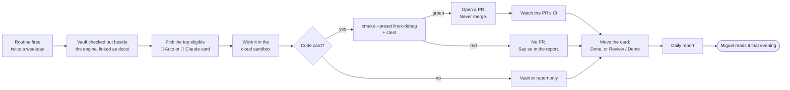

# 🤖 Autonomous Lane: Design

A second execution lane in every sprint. Claude runs eligible cards **unattended in a
claude.ai cloud routine**, on weekdays, while Miguel is at his day job and his PC is off.
Each run leaves a report he reads that evening.

**This note is the lane's only decision artifact. No ADR was cut** (2026-08-30). The lane is
process rather than a system, it is reversible by disabling one routine, and its boundary is a
list rather than an argument.

That puts weight on this note. § *Eligibility* and § *Hard stops* are **normative**, not
descriptive, and there is no second document to check them against.

The lane's interface: [[Autonomous Lane - Routine Prompt]] ·
[[Autonomous Run Report Template]]. Its gate: [[Planning Workflow - Artifact Gate]]
§ *The 🤖 Auto gate*.

Related: [[Technical Lead Charter]] · [[Working with Claude - Operating Guide]] ·
[[ADR-012 - Vault repository split]] · [[ADR-009 - Branching strategy & merge rules]]

## Why

Three sprints in a row closed with calendar left. Sprint 04 met its goal on **day 9 of 14**,
closing 13 cards in 7 working days against a model that sizes 6.5 per week. That is about
1.5x the sizing table.

**The 1.5x is not spare capacity.** The 2026-08-29 health check found the same overrun for
the third review running: two deep evenings each carried 1 🟢 + 1 🟠 + 1 🟡, and Fri Aug 28
closed four PRs on a 🟠 day. Refilling a sprint to 1.5x would make that overrun the plan.

**The finding underneath it is what this lane acts on.** Every overrun was *process* work,
not engine work. Sprint 04 ran **4 Process cards out of 13**, 31% of the sprint. Moving that
class of card off Miguel's days grows the sprint to roughly 17 cards while the attended half
stays at 13.

So the fix is a second lane, not a bigger per-day number. The [[Dashboard]] § *Rhythm*
capacity table does **not** change.

## Decided

| # | Question | Decision | Date |
|---|---|---|---|
| 1 | How far into code does the lane reach? | **Small code changes and behaviour-preserving refactors**, on top of mechanical work and small bug fixes. A change qualifies only when its card fully specifies the behaviour; a refactor only when the existing tests prove it, unedited. Never files an In Progress card or open PR is changing. Not design, and not a card the artifact gate routes to an ADR or a note. Widened from "small bug fixes" on 2026-09-26. | 2026-09-26 |
| 2 | Does a cloud run build before it opens a PR? | **Yes. Linux presets plus `ctest`, and a red build opens no PR.** CLAUDE.md's "Miguel compiles" rule is about his ownership of the toolchain, and he is not present in this lane, so the rule has no referent here. | 2026-08-30 |
| 3 | Where does the daily report land? | **One vault note per fire, in `docs/07 Journal/autoruns/<date>/`**, falling back to a rolling GitHub issue in the engine repo if a cloud session cannot reach the vault repo. Until 2026-09-26, all of a day's fires appended to one shared note; those were split per fire. | 2026-09-26 |
| 4 | Does the run get the vault? | **Yes, and it does not clone it.** The routine checks it out as a second `sources` repo, and the session symlinks it to `docs/` as its first act. Proven by the probe; no credential of any kind is involved. | 2026-08-30 |
| 5 | Does the run watch its own PR? | **Yes. It reports whether its PR is failing CI**, not just that it opened one: push early, check late (§ *Watching the PR*). | 2026-08-30 |
| 6 | Does the lane inherit the attended entry prompt? | **No. It gets its own.** The attended one assumes a human is present to compile, to decide and to answer a question mid-run. | 2026-08-30 |
| 7 | Does the lane move its card on the [[Sprint Board]]? | **Yes, and the columns are its state.** Done when every clause is met, Review / Demo when a PR is open or what is left needs Miguel. It grounds each 🤖 Auto or 🤖 Claude card with `/card-start` before working it, and closes its own cards with the whole of `/card-close`, the Dashboard's *Current focus* included. Attended cards stay Miguel's to close. Widened from "only the board line" on 2026-10-19 (S8-P9). | 2026-10-19 |
| 8 | Does the lane screen papers for the research chatbot? | **Yes, as report-only fallback work, and it never approves.** With no Auto card open, it screens a few cards from [[Research]]'s *TO VALIDATE* column into *MIGUEL REVIEW*: real title, stable link, one-sentence fit. An off-roadmap paper gets a "recommend reject" line; rejecting and approving (`/paper-validate`) stay Miguel's. Which column the chatbot ingests from is still undecided (Sep 19 review). | 2026-09-26 |
| 9 | Does the lane hunt for unnecessary code? | **Yes: with no Auto card open, the afternoon fire sweeps one module** for duplication, dead code and speculative abstractions, in rotation, and records the module's line count. It fixes every finding that needs no design decision: dead code nothing references (tests included, public API allowed, `sdk/` never), duplicates anywhere in one module, and copied test code. The fixes go in one PR with no size cap, one commit per finding, titled "Code sweep: <module>" on a `sweep/<module>-<date>` branch. Sweeps have no board card; that branch prefix is the one exception to CLAUDE.md rule 9. What is left goes into one rolled-up [[Backlog]] entry per module. The morning fire keeps the freshness check and paper screening. Widened from "obvious findings under ~100 lines, one entry each" on 2026-10-01. | 2026-10-01 |
| 10 | Does the lane build features? | **Yes: 🤖 Claude features**, picked by Miguel at `/sprint-plan`. The lane writes their engine logic and takes their design-note-level decisions, listing each in the PR; ADR-level decisions stay Miguel's. During the Sprint 09 trial they may sit on the critical path. The gate is [[Planning Workflow - Artifact Gate]] § *The 🤖 Claude gate*, and why the split exists is [[Technical Lead Charter]] § *Who writes the code*. | 2026-10-23 |

**Decision 2 is the one to watch.** It is the first carve-out from a CLAUDE.md rule rather
than an application of one, and it is what makes decision 1 safe. A small logic fix that
nobody compiled is negative value, because Miguel debugs it in the evening he was meant to
spend building.

## Mechanism

**claude.ai routines**, created with `/schedule` (the `RemoteTrigger` API). They execute in
Anthropic's cloud on a cron schedule, so the PC being off is irrelevant.

**Ruled out: `CronCreate` and `/loop`.** Both are session-only and in-memory, and jobs fire
only while the local REPL is idle. The `durable` flag has no effect. Neither survives the PC
going to sleep, which is the whole requirement.

**The routine is live**, created 2026-08-30 and cut to two fires a weekday on 2026-08-31. Its
configuration is in [[Autonomous Lane - Routine Prompt]] § *Routine configuration*. Every step
below has run unattended since September; its first merged PR was #66 on 2026-09-03.

## Watching the PR

**Decided 2026-08-30: push early, check late.** Polling in-session wastes about 16 minutes of
a run, and leaving it to the next day leaves a red PR unreported overnight. The run opens
its PR as soon as the work is green locally, then continues with the rest of its card list,
then reads the PR's checks as its last act before writing the report. CI runs during work the
session was doing anyway, so the wait costs nothing and the report is same-day.

**Floor:** if the checks have not settled by then, the report says so, and the next day's run
reads the result as its first act. A red PR is therefore reported within one day at worst.

A webhook trigger on the PR's check failure, firing a second routine, stays the upgrade path
if that floor ever gets hit often.

## Eligibility

Lane is **not a new kind**. A Process card run unattended is still a Process card, and the ID
keeps carrying the kind ([[Planning Workflow - Artifact Gate]] § *Task attributes*). Lane
rides the **weight** axis instead, because weight already answers "which slot does this run
in":

`· P2 · 🤖 Auto` and `· P1 · 🤖 Claude` join `🟢 Deep` / `🟠 Moderate` / `🟡 Light`.

**Eligible.** Research and technique evaluation. Vault freshness and drift checks. Backlog
trigger sweeps. Paper screening for [[Research]] (decision 8). Code sweeps for duplication and
unnecessary code (decision 9). CI failure diagnosis.
Mechanical code sweeps, of which S4-T2's `detail` to `internal` rename across 15 files is the
model case. Test scaffolding. Small, well-scoped bug fixes. Behaviour-preserving refactors, and
small code changes whose card fully specifies the behaviour (decision 1). Every code card needs
a green Linux build behind it.

**A refactor is proven by the tests as they stand.** If a test has to change for the refactor to
pass, the behaviour changed, and the card was not a refactor. Code with no test covering it can
still be refactored, but the PR says so plainly.

**The lane stays off Miguel's files.** A code card whose change would touch a file that an In
Progress card's branch or an open PR is changing stops before it starts. Two branches editing
one file is a merge conflict landing on his evening.

**Not eligible.** Anything the artifact gate routes to an ADR or a design note, because
decisions are Miguel's. Anything touching `.github/workflows/`. Anything whose done-condition
needs a Windows leg, a demo capture or a visual check. Anything on the sprint's critical path,
since an unattended lane cannot be a dependency.

**A 🤖 Claude card has its own gate** (decision 10). It may take design-note-level decisions,
add engine logic and, during the Sprint 09 trial, sit on the critical path. The Linux proof,
the workflow ban and the file check above still hold.

## Hard stops

- **It never merges.** A routine opens a PR and stops. This is not negotiable. #50 merged
  itself the moment its checks went green and carried half its change, because green checks
  cannot see an unstaged file.
- **It never commits to `master`**, in either repo, and it cuts branches as
  `<card ID>/<slug>` from a freshly fetched `origin/master` (CLAUDE.md rule 9).
- **No AI attribution in any commit or PR body** (CLAUDE.md rule 10), **and the author field
  counts.** Rule 10 names the trailer and the `🤖 Generated with` line, which are things a
  session *adds*. The sandbox ships a global git identity of `Claude <noreply@anthropic.com>`,
  so the author field is the one place this lane breaks the rule **by default rather than by
  slipping**. The environment's `GIT_AUTHOR_*` variables override it and step 1 of the prompt
  sets it again per repo, belt and braces, because losing either would be silent.
- **One PR per fire, so at most two per weekday.** See the cost model.

## Cost model

An Auto card costs zero of Miguel's day capacity and is **not free**.

| Cost | Amount | Notes |
|---|---|---|
| PR review | ~15 min each; ~30-45 min for a 🤖 Claude PR | Real capacity. Budget it on a 🟡 day, not on top of a 🟢 evening. A 🤖 Claude PR also lists decisions to accept or reverse. |
| CI, code card | 16.1 billed min | Measured, ADR-008 §9. At two per weekday that is ~650 min/month against the ~2k budget, about a third; at one, ~320 and about 16%. |
| CI, vault or report card | 0 | Vault commits take no PR, and a docs-only or `.claude/**` PR draws no CI since #54. |
| **Claude weekly usage** | the binding one | Every fire spends the weekly allowance whether or not it opens a PR, so a report-only day is **not** free here the way it is on the CI row. This is what cut the schedule from four fires to two on 2026-08-31. |

**The cap is one PR per fire, so two a day** (2026-10-01). Until then it was one per day
across both fires, and that rule turned out to block the wrong thing. On Oct 1 the morning's
#108 merged at 13:01, and the afternoon fire still could not open its sweep PR, so it filed
eight Backlog entries instead. Miguel accepted the worst case of ~650 CI minutes a month to
remove that. A morning PR still guards the afternoon through the file check in
§ *Eligibility*, because it is an open PR.

**Two fires, not four, since 2026-08-31, and the reason is the usage row rather than the CI
row.** Four fires a weekday spent enough of the weekly Claude allowance to compete with
Miguel's own attended sessions, which are the thing this lane exists to protect. The CI cap
never bound, because it is per day and was already one.

Prefer report-only and vault cards anyway. They cost nothing and they are the lowest-risk half
of the eligibility list.

**🤖 Claude features spend the most usage per fire** (2026-10-23). If the weekly allowance
starts squeezing Miguel's attended sessions, the fallback work gives way first: paper
screening, then the code sweep. The features are what the lane is now for.

## Lessons the lane runs on

The probes and first fires (2026-08-30 to 2026-09-04) found these. Most are now structural, in
the setup script or the prompt ([[Autonomous Lane - Routine Prompt]] § *Why the prompt is shaped
this way*); the rest are rules that still bite. The full probe log is in this note's history at
vault `731986a` and in the run reports under `07 Journal/autoruns/`.

| Lesson | Where it lives now |
|---|---|
| The vault mount is a **symlink**, and `.gitignore`'s `/docs/` matches directories only, so an auto PR could have committed it. | `.gitignore` says `/docs`; the prompt bans `git add -A`. |
| A prompt edit in the vault **does not reach the running routine**. | Every prompt change owes Miguel a manual paste. |
| With no Auto card open and a static `master`, the **second fire has no work by construction**, and it still spends the weekly usage. | Pause the routine, or seed the lane, across a gap with no cards. |
| A card left in To Do after a fire touched it reads as untaken. | Decision 7: the board's columns are the lane's state. |
| `allowed_tools` is **not a sandbox**; a probe with four read-only tools used others anyway. | The lane's safety rests on the prompt and on branch protection. |

**Considered and rejected: making the vault public** so the lane could read it. It publishes
the whole project brain, the company intent included, which is a far larger decision than this
lane, and the second `sources` entry made it unnecessary (decision 4).
