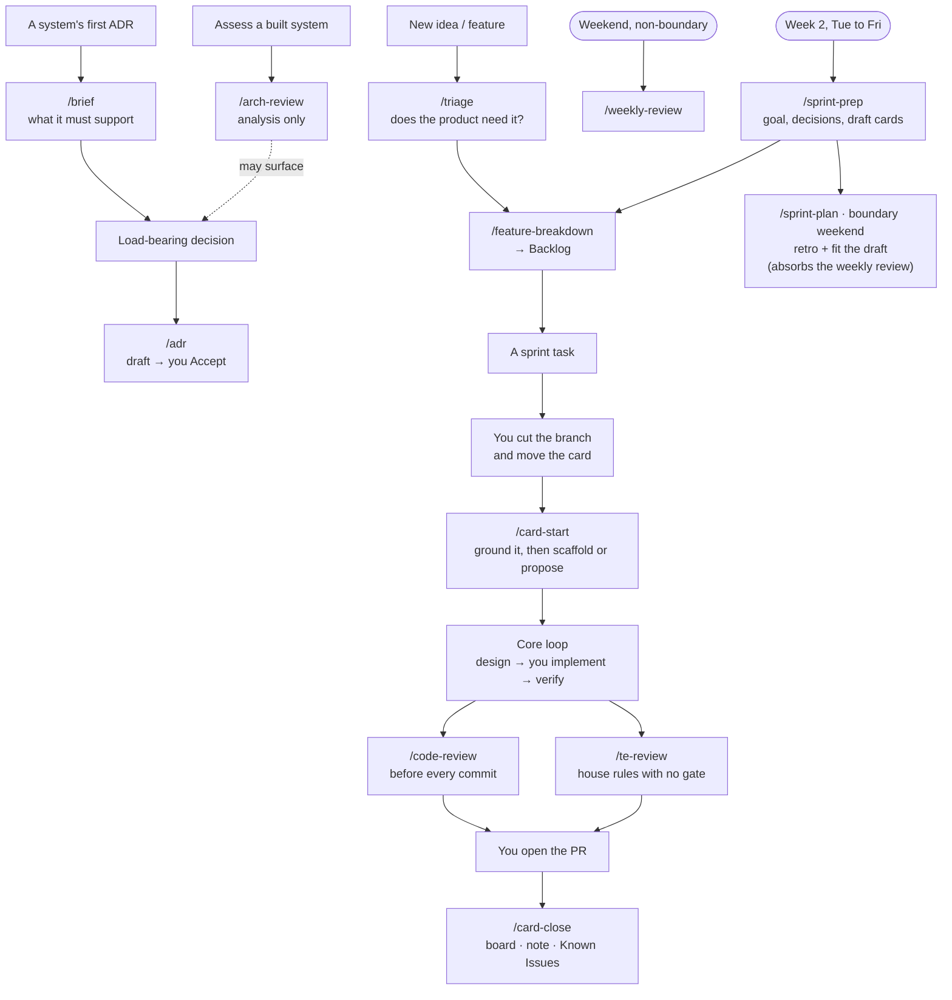

# 🤝 Working with Claude: Operating Guide

How to get high-quality, high-performance engine work out of Claude Code without
burning out. This is the *how-to*. The rules (Claude's role, who decides, who writes the code)
are the [[Technical Lead Charter]]; the machine-facing rules are the repo-root `CLAUDE.md`.

---

## Division of labor

The card's tag decides who writes it ([[Technical Lead Charter]] § *Who writes the code*):
your 🟢 and 🟠 cards are yours, with Claude pairing; 🤖 Auto and 🤖 Claude cards run in the
weekday lane, and you review their PRs, on a 🟡 day.

Rule of thumb for your own cards: bring Claude **decisions, designs, and finished code to
review**. Work you would rather not write belongs in a 🤖 Claude feature, picked at planning.

## The core loop (every non-trivial task)

> **Design (with Claude) → You implement → Claude reviews → iterate**

1. **Design**: discuss the approach with Claude first (plan mode is great here).
   Make it argue the trade-offs. Agree on the design before you write. This is
   where most mistakes die, cheaply.
2. **Scaffold (optional)**: ask Claude for boilerplate/skeletons if it saves
   time. You own the logic that goes inside them.
3. **Implement**: *you* write it, or hand Claude a function. One task at a time. A 🤖 Claude
   feature skips this loop: the lane implements it, and you review its PRs.
4. **Verify**: it must build; run the editor/demo if rendering changed. "Done"
   requires evidence.
5. **Review**: hand the diff to Claude (`/code-review`, or `/code-review ultra`
   for big/risky changes) before you commit. Nothing lands on the main branch
   directly.

## Session types → commands

The **weekly rhythm** (which day is deep/light/relaxed/off) lives on the [[Dashboard]];
follow that calendar. Match the session type to the day's mode:

| Mode | Session type | Commands |
|------|--------------|----------|
| Deep | Implementation | `/card-start` → core loop → `/code-review` → `/card-close` |
| Moderate | Lighter implementation: finish/refactor, wrap up | same, shorter |
| Light | Review the lanes' PRs, read code/docs, ADR drafting | `/card-review`, `/arch-review`, `/adr` |
| Relaxed | Optional light planning / docs, or rest | - |
| Off | No engine work | - |

Ceremonies (`/sprint-prep`, `/sprint-plan`, `/weekly-review`) run on the schedule in
[[Dashboard]] § *Rhythm*.

## Writing style (notes)

Vault notes are read by you and by Claude, often months later. Use tables and bullets
over prose, but write them as real sentences: no dropped articles and no keyword shorthand.
Keep one topic per note, and link instead of duplicating. Full rules: repo-root `CLAUDE.md`
→ *Token economy* → *The vault*.

## Slash commands (in `.claude/commands/`)

| Command                        | Use it for                                                |
| ------------------------------ | --------------------------------------------------------- |
| `/weekly-review [notes]`       | Weekend review → writes the journal + updates dashboard    |
| `/sprint-prep [focus]`         | Week 2: next sprint's goal, decisions and draft cards     |
| `/sprint-plan [focus]`         | Boundary weekend: retro, then fit the draft to capacity   |
| `/brief <system>`              | Product: interview you, then draft a system's capability brief, before its first ADR |
| `/triage <idea>`               | Product: weigh a new idea against the Capability Map before anyone designs it |
| `/showcase <goal>`             | Product: outline a goal's showcase video                   |
| `/product-review [focus]`      | Product: review the Vision, Reference Game and map at a quarter or phase boundary |
| `/adr <decision>`              | Draft an ADR for a load-bearing decision                  |
| `/arch-review <area>`          | Technical-lead review of a system (analysis, no edits)    |
| `/feature-breakdown <feature>` | Epic → Story → session-sized Tasks                        |
| `/card-start [card]`           | **After you branch and move the card:** checks both, grounds the card, then scaffolds a Dev card or proposes a solution for a planning card |
| `/card-review [card]`          | Review a card's implementation against its `done:` clauses, correctness, conventions and architecture |
| `/card-close [card]`           | **After the merge:** board entry, design note, [[Known Issues]], [[Backlog]], [[Dashboard]] *Now* |
| `/te-review [target]`          | House-rules review: `CONVENTIONS.md`'s judgment rows + the ADR structural invariants |
| `/paper-validate [papers]`     | Record papers you approved in `Paper.md` and move their [[Research]] cards |
| `/vault-clean [folder]`        | Sweep the vault for stale / redundant / malformed / orphaned content and tidy it |

Built-in ones worth habituating: **plan mode** for design, **`/code-review`**
before commits, **`/clear`** between tasks.

### When to reach for which

- **Cadence commands fire on the calendar** ([[Dashboard]] § *Rhythm*); the rest fire on a
  trigger.
- **Product commands fire on a trigger too:** an idea → `/triage`; a system's first ADR →
  `/brief`; a goal ending → `/showcase`; a quarter or phase opening → `/product-review`. Claude
  reminds you when one is owed (CLAUDE.md § *Product checkpoints*).
- **Work commands fire on a trigger, not the clock:** a load-bearing decision → `/adr`;
  decomposing a feature → `/feature-breakdown`; assessing existing code → `/arch-review`;
  before any commit → `/code-review`.
- **A card is bracketed by `/card-start` and `/card-close`.** You cut the branch (CLAUDE.md
  rule 9) and move the card to In Progress; `/card-start` treats both as gates and stops if
  either is missing. You open the PR, and a merged branch is dead (squash and linear history),
  never reused. The close's board entry is the retro's raw material.
- **`/card-close` reads the PR conversation, not just the diff.** A merged diff is an end state,
  so it cannot show what was written and then deleted, or what review caught. Those are usually
  the best lines on a card, and they exist only in the PR.
- **Agents support these, they don't replace them:** `/adr` can lean on
  `adr-consistency-checker`; research / prior-art during design → `engine-researcher` /
  `v1-reference-miner`.
- **Maintenance chore:** `/vault-clean` on a light/relaxed day (or at a sprint boundary)
  keeps the vault current and lean.

## Subagents (in `.claude/agents/`)

Delegated helpers Claude spins up for isolated / fan-out work; they keep heavy
searching and research out of the main design context. Ask for one by name, or let
Claude route to it. All are **read-only or research**: they report, they don't edit.

| Agent | Use it for |
|-------|-----------|
| `v1-reference-miner` | "How did v1 do X?" / the `file:line` behind an audit finding (F1-F35), mines the frozen `v1-reference` tag |
| `engine-researcher` | Evaluate a technique/paper/library in any sub-area (rendering, physics, netcode, ECS, audio, serialization, tooling) → cost + concrete TechEngine decisions (web) |
| `adr-consistency-checker` | Check a proposal against the **accepted** ADRs before you build on it |

---

## The five mistakes this setup is designed to prevent

1. **Accepting code you don't understand.** Rule: if you'd keep it, you must be
   able to explain it. Ask Claude to walk you through anything non-obvious.
   Small diffs make this possible.
2. **Silent rewrites.** Claude is instructed to bias toward refactor and to
   demand evidence before a rewrite. Hold it to that (see [[Principles]] #2).
3. **Context rot.** Long sessions degrade quality. One task, then `/clear`; a new idea
   mid-task goes to [[Backlog]], not into the current diff.
4. **Skipping verification.** "It builds / it doesn't" is stated every time.
   Rendering changes get a visual check, not a claim.
5. **Scope creep & burnout.** Capacity is finite. Claude is told your schedule
   and to flag when a session runs long or scope balloons, let it.

---

_Related: [[Technical Lead Charter]] (the rules) · repo-root `CLAUDE.md` § *Performance* and
§ *Testing* (the quality stance)_
